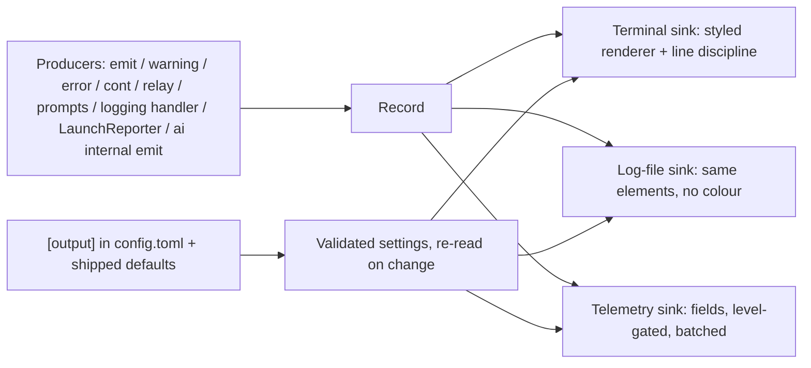

<!-- doc:region name="overview" kind="replaceable" -->

# Launcher Output Standard — Design Document

**Status:** DRAFT

**Created:** 2026-10-13

**Task:** AI-CLI-1o9b (epic), children AI-CLI-yxt0, AI-CLI-8h3u, AI-CLI-fx4b, AI-CLI-rbuf, AI-CLI-mu4d,
AI-CLI-2gq3, plus AI-CLI-zss5

**Research:** [docs/research/launch-sequence-progress-logging-cli-ux.md](../research/launch-sequence-progress-logging-cli-ux.md)

**Prior work:** [docs/plans/launch-output-contract-plan.md](../plans/launch-output-contract-plan.md) (PR #216),
[docs/plans/tagged-output-enforcement-plan.md](../plans/tagged-output-enforcement-plan.md) (AI-CLI-9brz)

## Table of Contents

- [Founding Ask Coverage](#founding-ask-coverage)
  - [Provenance: the asks, verbatim](#provenance-the-asks-verbatim)
  - [Conflicts between the records](#conflicts-between-the-records)
- [Executive Summary](#executive-summary)
- [Problem Statement](#problem-statement)
- [Design Overview](#design-overview)
- [Log-Line Model](#log-line-model)
  - [The record](#the-record)
  - [Elements and the default line](#elements-and-the-default-line)
  - [Producer interface](#producer-interface)
  - [Enforcement](#enforcement)
  - [Rendering](#rendering)
  - [Line discipline](#line-discipline)
  - [Sinks: terminal, log file, telemetry](#sinks-terminal-log-file-telemetry)
  - [Reload progress line](#reload-progress-line)
  - [Session-script producers](#session-script-producers)
- [Data Model](#data-model)
  - [Configuration schema](#configuration-schema)
  - [Validation and call-time reading](#validation-and-call-time-reading)
  - [Initial operation vocabulary](#initial-operation-vocabulary)
  - [Measured Rich import cost](#measured-rich-import-cost)
- [Integration](#integration)
- [Implementation Phases](#implementation-phases)
  - [Order and dependencies](#order-and-dependencies)
  - [Testing approach shared by every task](#testing-approach-shared-by-every-task)
  - [Phase 1: Line discipline](#phase-1-line-discipline)
  - [Phase 2: One renderer and its configuration](#phase-2-one-renderer-and-its-configuration)
  - [Phase 3: Datetime and operation elements](#phase-3-datetime-and-operation-elements)
  - [Phase 4: Reload progress](#phase-4-reload-progress)
  - [Phase 5: One record for every sink](#phase-5-one-record-for-every-sink)
- [Implementation Audit](#implementation-audit)
- [Risks and Mitigations](#risks-and-mitigations)
- [Design Decisions](#design-decisions)
  - [Decision Summary](#decision-summary)
  - [Decision Details](#decision-details)
  - [D-1: Output rendering library](#d-1)
  - [D-2: Where the output configuration lives](#d-2)
  - [D-3: Datetime presentation](#d-3)
  - [D-4: Reload progress display shape](#d-4)
  - [D-5: Behaviour on invalid output configuration](#d-5)
  - [D-6: Telemetry sink path](#d-6)
- [Open Questions](#open-questions)
- [Approval Log](#approval-log)

## Founding Ask Coverage

`founding_ask_ref`: N/A. This design is the epic's own first step and no canonical founding-ask
root was supplied. The maintainer's wording lives in the issue records of AI-CLI-1o9b, its six
children and AI-CLI-zss5 (exported 2026-10-13). Their load-bearing parts are quoted verbatim below.
This is a public repository, so private identifiers are redacted and each redaction is marked.

Coverage index (non-authoritative; the issue records govern):

| Issue | Ask in one line | Where this design answers it |
|---|---|---|
| AI-CLI-1o9b (2026-09-27) | One tag convention, a mainstream output library, colours and formatting, load bars | [D-1](#d-1), [Rendering](#rendering); tags already shipped in #216 and AI-CLI-9brz |
| AI-CLI-1o9b comment (2026-10-12) | The epic now covers terminal lines, the per-launch log file and telemetry | [Sinks](#sinks-terminal-log-file-telemetry), [Conflicts](#conflicts-between-the-records) item 1 |
| AI-CLI-yxt0 | Rich formatting enforced on every line; `[transport]` and `[dolt_server]` print plain | [Rendering](#rendering), [Enforcement](#enforcement), T-2 |
| AI-CLI-8h3u | Every record ends in a newline; `\r` lines are closed; remote and local never interleave mid-line | [Line discipline](#line-discipline), T-1 |
| AI-CLI-fx4b | A configurable datetime element on every line, 24-hour, US Eastern default | [Elements](#elements-and-the-default-line), [D-3](#d-3), T-4 |
| AI-CLI-rbuf | A mandatory, configurable `<operation>:` element | [Producer interface](#producer-interface), [Initial operation vocabulary](#initial-operation-vocabulary), T-5 |
| AI-CLI-mu4d | One config file for every element, validated at load, read at call time | [Configuration schema](#configuration-schema), [D-2](#d-2), [D-5](#d-5), T-3 |
| AI-CLI-2gq3 | Log file and telemetry share the record and the config | [Sinks](#sinks-terminal-log-file-telemetry), [D-6](#d-6), T-7 |
| AI-CLI-cuwe | Session-script lines reach the launch log, and their warnings and errors telemetry | [Sinks](#sinks-terminal-log-file-telemetry), [Session-script producers](#session-script-producers), T-7 as built |
| AI-CLI-zss5 | Replace the endlessly repeated reload line with a progress display that makes a stall more visible | [Reload progress line](#reload-progress-line), [D-4](#d-4), T-6 |

How two ambiguous phrases are read (both recoverable from the records, neither adds a requirement):

- **"format patterns (regex, validated at load ...)"** (mu4d) is read as two settings per element.
  `pattern` is the regex an element's value must match (tag names, operation names, the rendered
  datetime). `format` is the datetime's strftime format, which fx4b calls "the configured pattern".
  Delimiters are separate `prefix`/`suffix` settings.
- **"the `ai` launcher"** is read as the `ai` command as a whole, which is how the 2026-09-27 ask
  names it ("the ai-cli-utils `ai` session launcher"). AI-CLI-9brz already put every `ai` command
  behind one output interface, and yxt0 asks for this to be enforced "the same way". The record model
  therefore applies to every line any `ai` command prints, through that one interface.

### Provenance: the asks, verbatim

AI-CLI-1o9b, the original ask (2026-09-27):

> also, for the ai-cli-utils `ai` session launcher, can you standardize the output logging. i see
> some have `[...]` tags before like `[Launch]` and some output lines don't. also, is there a better
> output logging library that we can use. what are the best practice industry standards output
> logging libraries? like ones with colors and formatting and load bars etc? [process instructions
> naming private workflow tooling elided] i want the output logging for the ai session launcher to
> be standardized and have aesthetically pleasing and rich text formatting etc features. all the best
> practices and industry standards.

AI-CLI-1o9b, the re-scope comment (2026-10-12, relayed from the maintainer):

> this is promoted to the EPIC for ai-cli-utils launcher log-line output, the persistent log file,
> and observability/telemetry.

AI-CLI-yxt0 (2026-10-12):

> the [transport] and [dolt_server] lines print plain, without the rich colour and formatting every
> other tag gets [...]. Enforce rich formatting on EVERY output line, systematically, the same way
> AI-CLI-9brz enforced a log-type tag on every line through one output interface: no line may reach
> the terminal as plain text, and a test fails any producer that bypasses the formatter.
>
> Done when: every line from every producer (transport, dolt_server, update, launch, plan, ...)
> renders through the one formatter; an enforcement test proves no plain path remains; a live
> `ai c -R` reattach shows coloured [transport] and [dolt_server] lines.

AI-CLI-8h3u (2026-10-12). Session names, the project alias, the user name and the host name in the
captured transcripts are replaced with placeholders:

> log lines are concatenated on one line with no newline, e.g. `[transport] Connection lost (ssh exit
> 1) — reattaching in 2s (attempt 1[transport] Connection lost ...` repeated nine times, followed by
> `Starting Claude Code session ... this repo)sion mode)`; remote output overwrites local fragments;
> and the last line is prepended to the shell prompt (`...healthy (no beads store is routed to this
> repo)sion mode)<user>@<host> projects %`). Line termination must be enforced systematically by the
> output library: every record ends in a newline; an in-place progress line (`\r`) is always cleared
> and closed with a newline before any other line or before exit; remote and local streams never
> interleave mid-line.
>
> Done when: an `ai c -R` reattach loop and a terminal exit leave every line on its own line and a
> clean prompt; a test reproduces the `\r`-without-newline case and fails without the fix.

AI-CLI-fx4b (2026-10-12):

> every log line carries a datetime element in addition to `[<log-type>] <operation>: <description>`,
> visually distinct from the type tag (its own colour, or parentheses instead of brackets; choose per
> industry and open-source logging conventions and record the reasoning in the design doc). Default:
> 24-hour `YYYY-MM-DD HH:MM:SS <TZ>` in US Eastern via Python datetime/zoneinfo. The format,
> timezone, delimiter and colour are configurable (see the config child); the configured pattern is
> validated at load and an invalid one is refused with the file path.

AI-CLI-rbuf (2026-10-12):

> every log line includes an `<operation>:` element, rich-formatted and coloured. Today some lines
> (e.g. `[transport] Connection lost ...`, `[dolt_server] healthy ...`) have none. Enforce it in the
> output library's design, as elegantly as the log-type tag. Configurable: the operation vocabulary
> (allowed list), whether it is enforced or optional, the default, its colour and its pattern.

AI-CLI-mu4d (2026-10-12):

> fine-grained, config-file control of every log-line element for the `ai` launcher's terminal
> output: which elements are enabled (type tag, datetime, operation, description), their order,
> delimiters, colours, and format patterns (regex, validated at load, with the config path in any
> error), whether each is enforced or optional, the operation vocabulary, and the datetime
> format/timezone. Read at call time, not frozen at launch.

AI-CLI-2gq3 (2026-10-12):

> apply the same log-line model and config (type tag, datetime, operation, enforcement, colours where
> the sink supports them) to the `ai` launcher's persistent per-launch log file (from AI-CLI-28nz) and
> its observability/telemetry output, so the terminal, the file and telemetry share one structured
> record.

AI-CLI-zss5, the original request:

> also, i do not like how its logging output when ai-cli session script is updated and reloading. it
> just prints the same line out endlessly. we should have like a reload bar or some better TUI
> experience instead of print same line out endlessly. if we need to install and use some popular
> open source cli / tui tool to show a load bar or whatever is a better TUI experience for this
> loading use case, then let us do that.

AI-CLI-zss5, from its task details (the constraint that drives [D-4](#d-4)):

> Making the output prettier must not HIDE a stuck reload. A spinner that spins forever is worse than
> a repeated line because it looks healthy. Whatever replaces it must make a stall MORE visible: show
> an attempt count and escalate after N reloads.

### Conflicts between the records

Each conflict is resolved in favour of the later or more specific instruction, and is stated here so
nobody has to rediscover it.

1. **Scope.** The epic's original text puts "Log files, telemetry, or structured machine-readable
   logging" out of scope. The 2026-10-12 comment and AI-CLI-2gq3 bring the log file and telemetry in.
   The later instruction governs, so both are in scope.
2. **Python floor.** The epic says `requires-python` is `>=3.14,<3.15`. Measured on `06635ff`,
   `pyproject.toml` declares `requires-python = ">=3.11"`. Rich 15.0.0 declares `>=3.9.0`, so it
   fits the floor either way.
3. **The library question.** The research doc (2026-08-31) recommended no new dependency, and PR #216
   followed it (its plan's D-3: a Click-only reporter). The epic's comment on #216 states that the
   maintainer may overrule this. The 2026-10-12 children ask for "rich formatting" on every line, and
   the epic is now titled "with a rich-output library". That reopens the question, which is
   [D-1](#d-1).
4. **Weighing the dependency.** The epic says a new runtime dependency "is a real cost to every
   consumer; weigh it and say so". The maintainer's standing decision rule is that dependency count
   and install footprint are not weighed against an option unless a concrete constraint applies. D-1
   therefore weighs only measured effects (import latency, and terminal state a library could own).
   It states the transitive dependencies without scoring them.
5. **Timestamps.** The research doc advised no default timestamp. fx4b asks explicitly for one on
   every line. fx4b is later and explicit, so it governs.
6. **Newlines and in-place lines.** 8h3u says "every record ends in a newline", and zss5 wants a
   self-overwriting status line. 8h3u itself reconciles the two: an in-place line is allowed, but it
   is always closed before any other line or exit. [Line discipline](#line-discipline) rule L4 states
   that precisely.

## Executive Summary

Every line an `ai` command prints, its per-launch log file and its telemetry will come from one
structured record: a datetime, a type tag, an operation, a level and a description. One renderer
turns that record into a styled terminal line, a plain log-file line and a telemetry row, all
controlled by one `[output]` section of the existing `config.toml`, which is re-read whenever it
changes. A line-discipline layer underneath fixes the run-together reattach lines. Every record ends
at column 0 of a fresh line, even while ssh holds the terminal in raw mode, and the only line ever
left open is a progress line, which is closed before anything else is written. The repeated
"session script updated — reloading..." line becomes one in-place status line with an attempt count
that escalates to a warning and then a persistent error, so a stuck reload becomes louder rather
than hidden. The maintainer decided the rendering library ([D-1](#d-1)) on 2026-10-13: structlog
builds the record and Rich renders it, option (c). Live displays are wanted rather than banned, and
how to run them safely in tmux-wrapped sessions is researched in AI-CLI-g013, whose findings set the
live-display rules for T-2 and T-6. Where a section below says "if D-1 is (c)", that branch now
applies.

## Problem Statement

Measured at base `06635ff`:

1. **Plain lines.** `ai_cli.output` (AI-CLI-9brz) guarantees a tag but styles only what a caller
   asks for: the tag is dim, and a label or body is styled only when the caller passes one. Under
   `src/ai_cli/` there are about 528 calls into the interface (437 `emit`, 13 `warning`, 62 `error`,
   4 `run_relayed`, 12 `cont`). Outside `output.py` and `launch_reporter.py`, one passes a `label`.
   The about 83 `LaunchReporter` calls are the only lines with a coloured element after the tag. That
   is why `[transport]` and `[dolt_server]` print plain while `[launch]` does.
2. **Run-together lines.** `transport._StderrTee` relays ssh's stderr to the terminal every 0.1 s
   *while the ssh attempt is running*. OpenSSH's `enter_raw_mode()` clears `OPOST` on the local
   terminal (`tio.c_oflag &= ~OPOST;` in `sshtty.c`), so a `\n` written in that window moves down a
   row without returning to column 0. `transport.restore_terminal()` resets DEC private modes (mouse,
   paste, alternate screen) but not the termios output flags. No layer guarantees that a record starts
   at column 0, or that the process exits with the cursor on a fresh line. These are the mechanisms
   the 8h3u transcripts point to. T-1 starts by reproducing them, because the transcripts themselves
   are not in the repository ([Open Questions](#open-questions) 1).
3. **No datetime, no operation, no configuration.** The line grammar is `[tag] [Label: ]text`, fixed
   in code.
4. **The log file guesses.** The per-launch log mirrors rendered stderr text and recovers each line's
   level with a regex (`launch_logging._log_level`: a line containing " failed" is logged as ERROR).
   No log record reaches telemetry at all. The launcher's only telemetry is the session START/STOP
   events the session script publishes.
5. **The reload loop.** The generated session script's child prints `[session] session script
   updated — reloading...` with `echo` and exits 78. The supervisor restarts it, so a looping reload
   prints the identical line once per iteration, with no count and no elapsed time. The open
   regression AI-CLI-z86u is the cause of the loop. This design does not fix z86u; it makes z86u
   visible.

## Design Overview

**Status:** Phase 1 (T-1, AI-CLI-8h3u) implemented. Phase 2: T-2 (AI-CLI-yxt0) and T-3
(AI-CLI-mu4d) implemented. Phase 3: T-4 (AI-CLI-fx4b) and T-5 (AI-CLI-rbuf) implemented. Phase 4:
T-6 (AI-CLI-zss5) implemented; live reload check pending. Phase 5: T-7 (AI-CLI-2gq3) implemented;
live launch check pending.

Phase 1, as built under today's Click renderer:

- **One write per record (L1).** `output._write` renders a record and its terminator as one
  string and writes it once, under the module lock that `emit`, `cont`, `relay` and the
  stderr tee already share.
- **CR LF on a POSIX terminal (L2).** `output._eol` returns `\r\n` for a TTY when
  `os.name != "nt"`, and `\n` otherwise. A Windows console has no `OPOST`, and its
  text-mode stream already turns LF into CR LF.
- **Inert text (L3).** `output.inert` removes CSI and OSC sequences and other escapes, keeps
  only the last segment of a `\r`-redrawn line, expands tabs and removes the remaining C0
  and C1 characters. `render` applies it, so prompts and relayed lines get it too. `relay`
  splits child output on LF only. `str.splitlines` also split on CR, which turned a
  child's progress redraw into separate lines.
- **Open lines (L4).** The existing `nl=False`/`cont` line is closed with the stream's
  terminator before any other record. `flush_sinks()` also closes it, and runs at `atexit`
  and before every exec. No `progress()` producer exists yet: it arrives with its first
  caller, the T-6 reload line.
- **Foreign span (L5).** `run_ssh_with_reconnect` runs each attempt and the tee's final
  drain inside `output.foreign_terminal()`. A terminal record written in that span starts
  with CR and erase-line.
- **Terminal returned (L6).** `transport.restore_terminal()` calls
  `output.reclaim_terminal()` after its DEC-mode resets, once autowrap is back on.
  `reclaim_terminal()` sets `OPOST|ONLCR` again, only when they are off and only from the
  terminal's foreground process group, so it cannot raise SIGTTOU. A termios failure is
  ignored. It then writes the PROMPT_SP fence: a full row of spaces and CR, or CR LF when
  the width is unknown.
- **Exit (L7).** The transport `finally` path fences after the last attempt. The `atexit`
  flush closes any open line.
- **Exec helper.** Every `os.execvp` in the package goes through `main._exec_handoff`,
  which calls `flush_sinks()` first. `tests/test_output_enforcement.py` fails any other
  exec.
- **Found while reproducing.** `launch_logging._LoggingStderr` subclasses `typing.TextIO`,
  whose `isatty()`, `fileno()` and `encoding` are stubs returning `None`. After a launch
  installed the mirror, stderr therefore read as not a TTY, so lines lost their colour and
  L2/L6 could not see the terminal. The mirror now delegates the three, and it logs inert
  text, so CR LF and the fence never reach the log file.
- **Test model.** `pyte` 0.8.2 (dev dependency only) renders the screen. Adoption evidence:
  prompt-toolkit's `ptterm` and `termtosvg` both declare it as a runtime dependency in
  their `setup.py`. pyte does not parse a `<`-prefixed CSI, so the tests drop the kitty
  keyboard pop before rendering.

Phase 2, T-2, as built on D-1 (c):

- **The record.** `output.Record` is a frozen dataclass: `at` (aware UTC), `tag`, `text`,
  `level` (`detail`, `info`, `warning`, `error`), `op`, and three transitional fields.
  `label` and `label_style` carry the launch reporter's phase name until T-5 turns it
  into the operation element. `text_style` is the reporter's outcome style. `continued`
  marks the second and later lines of one message, which repeat the tag but not the
  label or level. `kind` and `fields` arrive with their first producers (T-6, T-7).
- **structlog builds it.** `structlog.wrap_logger` over a sink that returns the finished
  record, with three processors: a signature check (a `Tag` member, an op matching
  `^[a-z][a-z0-9-]*$`, a known level), a timestamp (kept when the caller supplies one,
  as the relay does), and the record builder, which also makes the text inert. It is a
  wrapped logger, not `structlog.configure`, so an application that imports `ai_cli`
  keeps its own structlog configuration.
- **Rich renders it.** `render_record(record, color=...)` builds one span per element
  (tag `bold blue`, op `bold cyan`, phase label `bold cyan`, `Warning:` `bold yellow`,
  `Error:` `bold red`) and captures them through one `Console` per stream, built with
  `markup=False`, `highlight=False`, `emoji=False`, `soft_wrap=True` and
  `force_terminal=True`. The colour decision stays `wants_color(stream)`; Rich picks the
  depth. A legacy Windows console renders plain. Without colour the same elements are
  joined as plain text, so a pipe never imports Rich.
- **Producers.** `emit`, `warning`, `error`, `cont`, `relay`, `run_relayed`, the prompts
  and `TaggedLogHandler` all build records. `warning`/`error` set the level instead of
  passing a styled label. `emit`, `relay` and `run_relayed` take an optional keyword
  `op`; T-5 makes it a required positional argument.
- **Structured relay.** `run_relayed` and the launch-time `ai update` call set
  `AI_CLI_RECORD_RELAY=1` for the child (`output.record_relay_env()`). A child `ai` reads
  and removes the flag at import, so it reaches only that child, and then writes each
  record as one JSON line marked `"ai_cli_record": 1`. `relay` re-emits a valid record
  with the child's tag, op, level and time, through the same pipeline checks. Any other
  line, a malformed record included, becomes the description of a caller's tag/op
  record. A child that was not asked for records (an older `ai`) still prints `[tag] ...` text; such a line is parsed back into a record with its own tag and level, so it is styled and tagged once.
- **`ai internal emit <tag> <info|warning|error> <terminal|plain> <text...>`** replies
  with one rendered record on stdout (`Untagged.INTERNAL_REPLY`). It runs before the
  `ai internal` config load. `terminal` styles the reply unless `NO_COLOR` or
  `TERM=dumb` says not to. Positional, like every other `ai internal` action.
- **`_ai_emit <level> <text>`** in the generated script runs `ai internal emit` and
  prints the reply itself. An empty reply or a non-zero exit (the entry point missing or
  mid-reinstall, or an older `ai` that does not know `emit`) prints the same grammar as
  plain text, so a message is never lost. In a supervisor that records its stderr in the
  launch log, fd 2 is the log relay, so the record goes to the terminal on fd 3 and the
  log gets the plain line. All 15 message sites use it; the levels match what each line
  printed before (one `warning`, the rest `info`). The renderer runs with SIGINT ignored, so
  a Ctrl+C cannot cost a message. The double Ctrl+C notice is rendered in the background:
  it is printed from the INT trap, and a shell drops a second SIGINT that lands while that
  trap is still running, which a 0.6 s render made likely (measured: the second press was
  lost and the session kept running). The op argument the design's
  `_ai_emit <level> <op> <text>` names is added with the rest of the operation migration
  in T-5.
- **Live-display owner.** `src/ai_cli/live_display.py` exists as a documented
  placeholder, so the enforcement rule below has a named owner. It contains no display.
- **Import cost.** structlog and Rich are imported on the first record, so `-V`, the
  statusline and `ai internal` replies import neither
  ([Measured Rich import cost](#measured-rich-import-cost)).

Phase 2, T-3, as built:

- **Settings.** `src/ai_cli/output_settings.py` holds the settings the renderer reads
  (frozen dataclasses), the loader and the call-time check. `src/ai_cli/output_validation.py`
  holds the schema (pydantic models with `extra="forbid"` and `strict=True`). The loader
  imports it only when `config.toml` has an `[output]` table, so with none a record never
  imports pydantic.
  `src/ai_cli/data/output.toml` holds every key's shipped value. A user's `[output]`
  table is merged over it key by key (tables merge, any other value replaces), then
  validated as a whole.
- **Shipped values differ from the schema block below in two keys.**
  `elements.datetime.enabled` is `false` and `elements.operation.required` is `false`,
  so a host with no `[output]` table renders T-2's bytes exactly (a golden test pins
  them). T-4 and T-5 turn both on with their behaviour. T-4 has done so for the
  datetime: the golden test runs with the element off, and
  `test_given_no_output_config_when_a_record_renders_then_the_datetime_leads_the_t2_bytes`
  pins the same bytes after the shipped datetime. In T-3 a user table that sets
  either to `true` is refused at load like any invalid value, naming the path and the
  key, with "true is not supported yet". Every other datetime and operation key is
  validated normally; checking the datetime `format` renders a strftime sample in the
  zone, which is validation, not rendering. T-4 and T-5 remove the two refusals.
  Decision: of (a) accept and ignore the two keys, (b) render them in T-3, and
  (c) refuse `true` until T-4/T-5, the driver chose (c) (Claude Opus 5.5, 2026-10-14):
  (a) leaves keys that silently do nothing, and (b) pulls T-4/T-5 rendering into T-3.
  <!-- decision-record: chosen-option=(c); ai-family=claude; ai-model=claude-opus-5-5; ai-profile=driver; decision-id=AI-CLI-mu4d/datetime-required-before-t4-t5 --> The `[output.sinks.*]`
  and `[output.progress.reload]` tables were not in T-3's schema, so a user table that set
  them was refused as unknown keys. T-6 added `[output.progress.reload]` and T-7 added
  `[output.sinks.*]`, each with its behaviour.
- **Two kinds of check.** Checks on one key run as pydantic validators, so they are
  all reported together. That covers types, unknown keys, style strings
  (`output.check_style`, Rich's `Style.parse`), regexes, the zone name, strftime
  directives, level names and element names. Checks that span keys run once every key
  is valid by itself. That covers `order` repeats and `description`, the disabled
  description, every `Tag` against the tag pattern, `tag.styles` names, the shipped
  vocabulary and the operation pattern, `default` and `operation.styles` names, and
  the datetime format rendered at a January and a July instant against its pattern.
  The shipped defaults are not validated at run time; a test validates them by
  supplying an empty `[output]` table.
- **Refusal (D-5).** Any error sets the whole user table aside. Records render with
  the shipped defaults, and each error becomes one
  `[config] load: Error: <path>: <dotted key>: <reason>` record on stderr, rendered
  with the shipped defaults. A list index is dropped from the key (`show.0` is
  reported as `show`). An unreadable file, invalid UTF-8 or invalid TOML is one error
  naming the path, with no key. An error set is printed once per process. When the
  file changes but the errors stay the same (for example the launch's own
  machine-profile write), it is not printed again.
- **Call time.** `render_record` asks `output_settings.current()` for settings before
  every record, under the output lock. `current()` stats the file. It re-reads only
  when the path, mtime, size or inode changed, so the cost per record is one `stat`.
  It resolves the config path without the old-directory migration, so rendering never
  moves a user's directory. The session script needs nothing more: each `_ai_emit` is
  its own `ai internal emit` process, which reads the file afresh. That process's
  stderr goes to `/dev/null`, so a config error is not shown on that path and the
  reply renders with the defaults.
- **Phase labels.** The launch reporter's phase label renders in the operation
  element's place, with its prefix and suffix, in `label_style` or else the operation
  style. The reporter no longer passes the phase style itself, so `operation.style`
  colours phase labels. `Ready:` and a failed outcome keep the reporter's own styles
  until T-5.
- **Import cost.** Every session-script message is one `ai internal emit`, so the
  no-table path must stay cheap. In the first version every record imported pydantic and
  validated the shipped defaults. `ai_cli.output_settings` then cost 72–91 ms cumulative
  under `-X importtime`, and `ai internal emit session info plain hello` took 0.61–0.70 s
  wall clock (6 runs, best 0.61 s). The driver measured main at about 0.35 s best case.
  With the split, the module costs 2.9–3.4 ms (3 runs) and the same command takes
  0.38–0.56 s (6 runs, best 0.38 s, measured 2026-10-14 on a busy host).
  `test_given_no_user_output_table_when_ai_internal_emit_runs_then_validation_is_not_imported`
  checks in a fresh interpreter that neither pydantic nor the validation module is
  imported without a user table, and that both are imported with one.
- **Found while testing.** About fifteen launch tests, and the subprocess driver in
  `tests/test_line_discipline.py`, patch `sys.platform` to `linux` for the whole
  process. On macOS, any stdlib module that first reads `sysconfig` after the patch
  then fails to import, depending on test order. zoneinfo is one, and pydantic imports
  it on the first record. `tests/conftest.py` and the driver now read the build config
  before any test runs.

Phase 3, T-5, as built:

- **Every producer names an operation.** `emit`, `warning`, `error`, `cont`, `relay`,
  `run_relayed`, `confirm`, `ask` and `render` take `op` as the second positional
  argument, typed `str`. `output.require_op` refuses an operation the vocabulary does
  not name with `ValueError`, as `_require_tag` refuses a non-`Tag` with `TypeError`. A
  shipped operation is checked against a cached set, so the check costs no `stat`; only
  an operation a user added reads the current config. `output.vocabulary()` is the
  shipped list plus the user's additions.
- **Two adapters pass none.** `TaggedLogHandler` (a stdlib logging record) goes through
  the private `_emit`, which takes `op=None`. A relayed child line with no operation of
  its own takes the caller's, which `relay` now requires, so the "foreign line without
  one" path the Producer interface names no longer exists. With `required = true` an
  op-less record renders the configured `default` (`[log] general: ...`); with `false`
  it renders without the element. Continuation lines repeat the operation, as they
  repeat the tag.
- **The launch reporter's phases are operations.** `Record.label` and
  `Record.label_style` are gone. `phase(op, ...)`, `detail(op, ...)`, `warning(op, ...)`
  and `error(op, ...)` take a vocabulary operation and check it on every call, even
  when `-q` or a non-verbose run suppresses the line. `start()` writes
  `start: Starting <Engine> session (<mode>)` and `handoff()` writes
  `handoff: ready, handing off to ...`, styled by `operation.styles.handoff`. A failed or
  interrupted phase is a record at error or warning level under the phase's operation,
  so the level element colours it; the reporter no longer passes its own red. The tmux
  report's `Mode` phase is `mode`.
- **Relay keeps the child's operation.** A child line already rendered as
  `[tag] op: ...` keeps its tag and operation when the word before the colon is in the
  vocabulary; other text before a colon stays in the description. An `ai` that predates
  operations writes `[tag] text`, which takes the caller's operation.
- **The session script.** `_ai_emit <level> <op> <text>` runs
  `ai internal emit session <level> <op> <terminal|plain> <text>`, and its plain
  fallback prints `[session] <op>: [Warning: |Error: ]<text>`. A script generated by an
  older `ai` passes no operation, so the new `ai internal emit` refuses its arguments and
  the script prints its own plain line: no message is lost across the upgrade. The 15
  message sites use `session`, `exit`, `terminal`, `cleanup`, `direnv`, `reload` and
  `refresh`, each at the level it printed before. `ai internal emit` refuses an
  operation outside the configured vocabulary, so one a user adds to `[output]` works
  there.
- **Enforcement.** `test_given_the_package_source_when_scanned_then_every_output_call_passes_a_vocabulary_operation`
  scans every `ai_cli.output` call and every launch-reporter call. The operation must be
  a string literal in the shipped vocabulary. Three named adapters may pass a variable:
  the reporter's `_emit` and `detail`, which forward their caller's literal, and the tmux
  report loop in `_do_session_launch`, whose phase literals in `tmux_setup.report_lines`
  the same test checks. The session-script scan also requires a vocabulary operation on
  every `_ai_emit`. Every module was migrated in this change, so the shrinking
  unmigrated-module allowlist the batching plan allowed was never needed.
- **Config.** The T-3 refusal of `required = true` is removed and the shipped default is
  `true`. The other operation checks (a vocabulary missing a shipped name, an entry
  failing the pattern, unknown `default` and `styles` names) were already in T-3.
- **Launch log.** `launch_logging._log_level` skips the operation element as well as the
  tag, so `[launch] tmux: Error: ...` is still logged at ERROR until T-7 removes the
  heuristic.

Phase 3, T-4, as built:

- **On by default.** `elements.datetime.enabled` ships `true`, and the T-3 refusal of
  `true` is gone. Every record renders its time first, bare and dim, as D-3 chose:
  `2026-07-01 14:30:00 EDT [launch] ...`. `enabled = false` turns it off.
- **One instant per record.** The time is the record's `at`, captured once when the
  record is built (UTC). `emit` captures it once per message, so every line of a
  multi-line message shows the same time. A relayed child record keeps the child's
  time.
- **Rendering.** `output.format_datetime` converts `at` to the configured zone and
  applies the strftime `format`. `output.resolve_zone` maps `UTC` to `datetime.UTC`,
  `local` to the host's zone (read per record, so a host zone change applies), and any
  other name to `zoneinfo.ZoneInfo`, cached per name. The validator renders its two
  samples through the same function, so what is checked at load is what renders. On
  Windows the `tzdata` dependency (already declared for `win32`) supplies the zone
  database.
- **Cost.** zoneinfo is imported on the first datetime, never at module load, so
  `--version` and the statusline do not pay for it. Its increment on the record path
  is 5–7 ms under `-X importtime` (4 runs, with `ai_cli.main`, structlog and Rich
  already imported). A record still constructs no `pathlib.Path`: `ZoneInfo` finds a
  system zone file through `os.path`. `ai internal emit session info terminal hello`,
  run 12 times interleaved with the T-3 base on a busy host (2026-10-14), took
  0.45–0.80 s (median 0.55 s) against the base's 0.45–0.90 s (median 0.59 s): no
  measurable change.
- **Session script.** When `ai internal emit` cannot render, `_ai_emit`'s plain line now
  leads with `TZ=America/New_York date '+%Y-%m-%d %H:%M:%S %Z'`, the default format. The
  supervisor's stderr relay, which prefixes `[session]` to a line with no tag, also
  passes through a line that starts with a date and carries a `[tag]`, so a rendered
  record is not tagged twice.

Phase 4, T-6, as built:

- **The child names the reason and stays quiet.** Instead of printing a line, a child
  that reloads writes `script-updated` (the stable script's mtime changed) or
  `ai-cli-updated` (the template was refreshed after an update) to
  `session-reload-reason-<session>` in the state directory, then exits 78.
- **The supervisor counts.** After each child it restores the terminal's foreground
  group, then reads and removes the reason file. A child that left a reason extends the
  run of consecutive reloads; any other exit, including the remote recovery shell's
  `exit 78` relaunch, resets it. The file rather than the exit status is the signal:
  macOS CI showed a reload whose row never appeared, consistent with the child's status
  being lost to the stop its promotion left pending (see the zsh fix below). The row is drawn only when the restore
  succeeded, so the supervisor writes only while it holds the foreground group.
  Measured while testing: the supervisor is a session leader whose parent is outside
  its session, so its process group is orphaned and a background write gets `EIO`
  rather than `SIGTTOU`. Without the gate the row would be lost, not stopped. The
  `TOSTOP` test therefore proves that no process stops; no supervisor-side mutation
  turns it red.
- **Found while testing (fixed separately).** Under zsh a child that exits at once
  after its promotion lost its status: the first `wait` reported the shim's stop
  (128 + SIGSTOP), so a clean 77 respawned forever and a 78 read as a plain restart.
  `_supervisor_wait_for_child` now waits once more for a child that is gone. That
  second `wait` still misread the exit on macOS (19, SIGCONT's number there, in place
  of 77), so the shim no longer stops at all: it parks in `sigwait` for the
  promotion's SIGCONT, and zsh has only the real exit to report (AI-CLI-k6ce).
- **`ai internal progress <tag> <op> <terminal|plain> <attempt> <started> <reason>`**
  renders the row: `[session] reload: session script updated, reloading (attempt 3, 4s)`.
  `started` is the epoch second of the first reload in the run, and the elapsed time is
  whole seconds. It reads `[output.progress.reload]` at call time: from `warn_after` the
  row is at warning level, from `error_after` at error level, and at exactly
  `error_after` the reply leads with one error record, `reloaded 6 times in a row in 9s
  without reaching the agent; press Ctrl+C twice within 3 seconds to stop the session`.
  Like `emit`, it runs before the `ai internal` config load.
- **In place, not live.** `output.render_progress` puts CR and erase-line (`_CLEAR_ROW`)
  before the rendered record, with no terminator, so each frame overwrites the last.
  The persistent error is its own frame ended with CR LF, so it stays in scrollback
  above the row. A `plain` target (stderr not a terminal, or `TERM=dumb`) replies with
  ordinary lines and the supervisor ends each with a newline. No refresh thread, no
  Rich live display: `live_display.py` stays the placeholder owner.
- **Open-row marker.** After printing an in-place row the supervisor creates
  `session-progress-open-<session>`. `_ai_close_progress` writes CR LF and removes it,
  in shell. `_ai_emit` calls it first, the child calls it as soon as its loop-top check
  decides not to reload (before the watcher, direnv and the agent can write), and the
  supervisor's EXIT trap calls it. A new supervisor removes a stale marker without
  writing.
- **Fallback.** When `ai internal progress` fails or replies empty, the supervisor
  prints the same text through `_ai_emit info reload`, which closes the open row and,
  if the renderer is still unavailable, prints `[session] reload: ... (attempt N, Ts)`
  as plain text. The loop is unchanged.
- **No `kind` on the record.** The row is the whole reply of a one-shot process, so
  `Record` needed no `kind` field, and no in-process `progress()` producer exists. Both
  arrive with the first in-process caller.
- **Supervisors already running** keep their old code, because a reload replaces only
  the child. Under such a supervisor a new child's reload is silent: it no longer prints
  the old line, and the old supervisor has no row to draw. Once its tmux session is
  started again, the session gets the row. No compatibility path was added (pre-v1 rule).
- **Cost.** Each reload costs one `ai internal progress`, the same Python start as one
  `ai internal emit`, and nothing on a launch without reloads.

Phase 5, T-7, as built:

- **One dispatch.** `output._write_records` sends each batch of records to the terminal,
  to the attached file sink and to the telemetry buffer, under the output lock, reading
  the settings once for the batch. `emit(..., terminal=False)` keeps a record off the
  terminal only. `LaunchReporter` uses it for a `-q` launch's info lines and for detail
  lines without `-v`, so the file still gets them. The reporter no longer takes a
  `logger`. A child `ai` that answers its parent in records writes to no sink itself;
  the parent's sinks get the relayed records.
- **File sink.** `output.attach_file_sink(callable)` takes one plain line per record. The
  launch attaches `LaunchLog.write_line` for exactly the launch and detaches it in the
  launch's `finally`. A record renders with the configured elements and no colour; the
  datetime is switched on, and put first when `order` leaves it out. The file has no
  separate level column: like the terminal, a warning or error carries its label and
  an info line carries none.
- **Non-record text.** The stderr mirror (`_LoggingStderr`) is an
  `output.MirroredStream`. `_write` writes a record to its `unmirrored` stream, so the
  mirror sees only text that is not a record, which it logs as `<datetime> <text>`
  (`output.file_text_line`). `_log_level`, the stdlib `logging` handler and its
  `asctime LEVEL` format are gone.
- **A log that cannot be written.** `create_launch_log` returns `LaunchLog(path=None)`
  when the directory or the file cannot be created, and the session script then gets no
  log path. A write that fails closes the file and drops the line.
- **Telemetry sink.** A record at or above `min_level` is buffered as one
  `telemetry.log.<tag>` event while `[output.sinks.telemetry] enabled` and
  `[telemetry] enabled` both allow it. The second is read from the same cached parse of
  `config.toml` (`output_settings.telemetry_enabled()`), so it costs no extra `stat`.
  The event's data is `at` (ISO 8601 in the configured datetime zone, so its offset
  matches the terminal's zone), `tag`, `op` (the operation the line shows, the default
  for an op-less record), `level` and `text`. The row's `ts` is the record's instant.
  `flush_sinks()` hands the batch to `telemetry.store_log_records`: one transaction,
  `BEGIN IMMEDIATE` first with no busy timeout, so a store another writer holds fails at
  once and is never waited for. Only a batch that holds the lock looks up its rows'
  machine id. Any exception drops the batch silently; the launch log still has every
  record (AI-CLI-n0d7). It runs at
  `LaunchReporter.handoff()` (a remote session holds the terminal for hours without
  exec'ing), in the exec helper, before the pty handoff, and at exit.
- **No `fields` yet.** No producer passes structured extras, so `Record` has no `fields`
  mapping and an event carries the five elements only. It arrives with its first
  producer.
- **The session script's lines (AI-CLI-cuwe).** `ai internal emit` and
  `ai internal progress` still reply through `raw()`, so the script prints the line,
  and `ai internal emit` then hands every record to `output.store()`, which is
  `_write_records(..., terminal=False)`: the same file and telemetry path as a launch's
  records, then `flush_sinks()` before the process exits. The command filters nothing
  by level: `[output.sinks.*]` decides what each sink keeps, so with the shipped
  defaults the file takes every level and telemetry warnings and errors. The file sink
  gained a `min_level` (default `detail`) for this, so the settings decide for both.
  `ai internal progress` stores only an escalated row, and the persistent stall error
  with it: a row that has not escalated is replaced by the next one, so it is transient.
  - *Which log.* The script outlives the launch that wrote it, and its records belong
    to that launch's log: the path baked into the script as `_ai_launch_log`, which
    `refresh-template` carries over from the metadata, and where the supervisor's
    stderr relay already writes. A child body and its supervisor share it.
  - *How the command finds it.* Each call passes the path in `AI_CLI_LAUNCH_LOG`, set
    on that command only, and `launch_logging.open_launch_log()` reopens the existing
    file for appending. It never creates one, so a log that was pruned or never created
    records nothing. The telemetry store needs no lookup: `telemetry.py` resolves it
    under the home directory at call time. An info line costs one append to the log;
    a warning also adds the telemetry module's import and one batch write.
  - *The plain lines.* The script no longer appends its own UTC-stamped copy of every
    message to the log. When the renderer cannot run (the command fails or replies
    empty), it appends the plain fallback line, at any level, so the message is never
    lost from the log. Before this change the supervisor appended every message and a
    child body appended none.
  - *Cost.* Measured 2026-10-14 under load (7.5 to 10 on 10 cores), against `origin/main`
    at `006d271` unpacked into its own directory, runs interleaved, HOME and XDG
    directories isolated, wall time from `/usr/bin/time -p`. `ai internal emit session
    <level> reload plain hello` with `AI_CLI_LAUNCH_LOG` set, on the first revision, which
    did not yet store info lines: an info line took a median of
    0.54 s on the base and 0.52 s on this branch (20 runs each). A warning, which now
    appends to the log and stores one telemetry event, took 0.52 s and 0.555 s in one pass
    and 0.505 s and 0.50 s in a second (20 runs each): no change outside the noise.
- **Found while building.** `telemetry._DB_PATH` was computed at import, so a process
  whose HOME changed after import wrote the store under the old home. The test suite
  is such a process, and with this sink its warnings would have reached the operator's
  real store. The path is now resolved at call time, `tests/conftest.py` drops buffered
  records and any attached launch log when a test ends, and `telemetry.py` imports
  `asyncio` only on its bus paths.
- **Cost.** Measured 2026-10-14 on the same host under load (8–11 on 10 cores), against
  `origin/main` at `1a29912` unpacked into its own directory, runs interleaved, HOME and
  XDG directories isolated. `ai c 7 --dry-run`, which ends on six error records and so
  stores six events at exit, took a median of 0.68 s on the base, 0.66 s with the sink
  and 0.71 s with `[telemetry] enabled = false` (10 runs each). `ai internal emit
  session warning reload plain hello` took a median of 0.56 s on the base and 0.59 s
  on this branch (20 runs each), with the same modules imported: no measurable change.
  In process, a flush that stores six events took a median of 3–6 ms. With the store
  locked by another writer it took 61 ms (max 64 ms over 10) with a 50 ms timeout, and
  159 ms on a macOS CI runner. With `BEGIN IMMEDIATE` and 30 ms it took 37 ms (max 39 ms
  over 15) here, but still 102 to 110 ms on the macOS runner. SQLite spends any busy
  timeout as a run of short sleeps, and a loaded macOS runner overshoots each one, so no
  timeout above zero bounds the wait there. AI-CLI-n0d7 removed the wait: the locked
  case now takes about 1 ms here, and the machine-id lookup (64 ms on its first call in
  a process) runs only once the lock is held. On this host
  `sqlite3.connect` itself stalled for about 165 ms in 2 of 60 samples in one run and
  in none of 60 in the next. That stall is in the file open, which no SQLite timeout
  bounds, so a writable store can rarely exceed the 100 ms budget.

Root cause of the run-together lines, as reproduced. While a foreign program has `OPOST`
off, a record ending in a bare LF moves down a row without returning to column 0. Before
the fix every record ended that way, from the tee's relay mid-attempt and from every
notice after an attempt that left the flags off. Separately, nothing put the cursor on a
fresh row when the terminal came back. A remote partial line or a remote bare CR
therefore stayed on the cursor's row, so the next local line, or the shell prompt after
exit, joined it or left the old line's tail on screen.

## Log-Line Model



### The record

One immutable record per logical line. Every producer builds one, and every sink consumes one.
Pseudocode, not an implementation:

```text
Record
  at:      aware datetime, captured once when the record is created (UTC internally)
  tag:     Tag                     # the existing closed enum; unchanged
  op:      str | None              # operation; None only through the two adapters named below
  level:   detail | info | warning | error
  text:    str                     # the description: one line, control characters made inert
  kind:    line | progress | prompt
  fields:  mapping[str, str | int | float]   # structured extras: attempt=3, elapsed_s=4.2, exit=255
```

Multi-line messages become one record per line, as `emit` already does today. `kind=progress` is
the only kind that may leave a line open on a terminal ([Line discipline](#line-discipline) rule
L4). `kind=prompt` keeps today's `ask`/`confirm` behaviour: the terminal echoes the user's Enter, and
that closes the line.

### Elements and the default line

Five elements, in this default order: `datetime`, `tag`, `operation`, `level`, `description`.

```text
2026-10-13 14:03:07 EDT [transport] reconnect: Warning: connection lost (ssh exit 255) after 4m12s; reattaching in 2s (attempt 1/9)
2026-10-13 14:03:09 EDT [dolt_server] ensure: healthy (socket accepted)
2026-10-13 14:03:11 EDT [launch] handoff: ready, handing off to Claude Code (session-1)
```

- **datetime** is first and bare, in its own colour (dim by default). The reasoning is in
  [D-3](#d-3). Default format `%Y-%m-%d %H:%M:%S %Z`, default zone `America/New_York` (the
  maintainer's explicit default). `UTC` and `local` are also accepted.
- **tag** is `[tag]`, as today.
- **operation** is `op:`, lower-case kebab-case, from the configured vocabulary
  ([Initial operation vocabulary](#initial-operation-vocabulary)).
- **level** is rendered only for `warning` and `error`, as `Warning:` and `Error:`, in today's
  colours. It sits next to the description, so the `[tag] op:` prefix the maintainer specified stays
  contiguous, and a warning still reads `... Warning: <text>` as it does today. `detail` records are
  verbose-only on the terminal, as `LaunchReporter.detail` is today.
- **description** is the text.

The launcher's phase grammar maps onto this model as follows. The phase label becomes the operation
(`Worktree:` becomes `worktree:`), `Starting ... session` becomes `start:`, and `Ready:` becomes
`handoff:`. Heartbeats, elapsed suffixes, `done`, `interrupted after`, `failed after`, the quiet and
verbose split and never-quiet warnings are all preserved (parity inventory in T-5).

**If D-1 is (b) or (c):** the elements, order and default line are identical. Only the colour depth
differs ([Rendering](#rendering)).

### Producer interface

The public calls keep their names, and each gains a required operation:

```text
emit(tag: Tag, op: str, message, *, err=False, file=None, nl=True, fields=None)
warning(tag: Tag, op: str, message, *, file=None, fields=None)
error(tag: Tag, op: str, message, *, file=None, fields=None)
cont(tag: Tag, op: str, message, ...)
progress(tag: Tag, op: str, message, *, fields=None)        # kind=progress
close_progress()                                            # explicit close; also automatic
run_relayed(tag: Tag, op: str, argv, **kwargs)              # every relayed line gets this op
raw(reason: Untagged, text, ...)                            # unchanged: the named untagged allowlist
parse_line(line, settings) -> Record fields | None          # for tests and the relay fallback
flush_sinks()                                               # before any exec or handoff
```

- `op` is positional and required, so omitting it is a `TypeError` at the call and a type-checker
  error. That is the same strength the `Tag` argument already has.
- Only two adapters may pass `op=None`. One is `TaggedLogHandler`, because stdlib logging records
  carry no operation. The other is the relay of a *foreign* child line when the caller's op was not
  supplied, a path T-5 removes. A `None` resolves to the configured `default` operation when the
  operation is `required`, or to no operation element when config marks it optional.
- **Structured relay between `ai` processes.** When `run_relayed` runs another `ai` process, for
  example a child `ai update`, it sets an environment flag. Under that flag the child's formatter
  writes one JSON record per line instead of styled text. The parent re-emits each one with the
  child's own tag, op, level and timestamp. This replaces today's `^\[tag\] ` sniffing in `relay`,
  which cannot work once a datetime leads the line, and it ends the `[update] [update]` class of
  double tags by construction. A line that does not parse as a record is relayed as a description
  under the caller's tag and op.

### Enforcement

`tests/test_output_enforcement.py` keeps its AST scan of every terminal write, and gains four rules:

1. Every call to `emit`, `warning`, `error`, `cont`, `progress` and `run_relayed` passes an `op`. The
   op must be a string literal that appears in the shipped default vocabulary, or a name from the
   named adapter allowlist.
2. No styling outside the output module: no `click.style`/`click.secho`, no `rich` import, and no
   ANSI escape literal (`\x1b[`, `\033[`). Two named exceptions remain: the terminal-restore
   sequences in `transport.py` (`_TERMINAL_RESTORE`), and `quota.py`, whose statusline segments
   carry their own SGR because Claude Code renders them verbatim and the statusline must not
   import Rich. The session script's agent-terminal reset is no longer an exception: since
   AI-CLI-no36 it renders `_TERMINAL_RESTORE` rather than carrying its own copy.
3. **Live displays have one owner** (D-1 (c) wants them; this replaces the ban option (a)
   carried). Every Rich `Live`, `Progress` or `Status` is entered through one owner module,
   `src/ai_cli/live_display.py`, which tears it down before anything else can own the terminal:
   on context exit, in `flush_sinks()` (so every exec and `atexit`), on `foreign_terminal()`
   entry, in the SIGTERM and SIGHUP handlers, and before any child that inherits the terminal.
   The rule and its three tests come from
   [the live-display research](../research/rich-live-displays-in-wrapped-sessions.md), section 5
   and finding B-4. T-2 ships the first test: an AST scan that fails any import of `rich.live`,
   `rich.progress` or `rich.status`, and any `Console.status` call, outside the owner. The owner
   itself, and the pty exit-path and non-TTY tests, come with the first live display
   (AI-CLI-zss5); its signal handlers come with AI-CLI-a1vv.
4. Every `os.exec*` call site, and the transport handoff, is preceded by `flush_sinks()` and by
   closing any open progress line. The test checks this by routing every exec through one helper
   that does both, and banning direct `os.exec*` elsewhere.

The session-script scan tightens in the same way: every message the generated script prints goes
through its `_ai_emit` shell function ([Session-script producers](#session-script-producers)), never
a bare `echo`/`printf`.

### Rendering

"Rich renders, we write." The renderer turns a record into a styled string for one sink. The line
discipline layer, not the library, writes that string to the stream. So whichever library is chosen,
it never owns the stream, the cursor or any terminal state.

**Under D-1 (a), Rich (recommended):**

- One `rich.console.Console` per sink stream is created lazily, with fixed flags: `markup=False`,
  `highlight=False`, `emoji=False` and `soft_wrap=True`. A probe on Rich 15.0.0 showed why two of
  these are mandatory. With markup on, `[transport] ...` is swallowed silently as a markup tag. With
  soft wrap off, a long line is hard-wrapped at the console width into several lines, which breaks
  "one record, one line".
- Records render as `rich.text.Text` spans, one per element, each styled from config. The string is
  produced with `Console.capture()` and handed to the writer.
- **Who decides colour.** The colour decision stays the package's own `wants_color(stream)`: a TTY,
  `NO_COLOR` unset or empty, and `TERM` not `dumb`. It is passed to Rich explicitly, so Rich's own
  environment detection cannot diverge from today's contract. Rich still chooses the colour *depth*:
  on a 16-colour terminal, `#ff8800` was downgraded to bright red in the probe.
- **Windows.** When Rich reports a legacy Windows console with no virtual-terminal support, the record
  renders without colour rather than writing escape bytes the console would print literally.
- **Lazy import.** Rich is imported on the first rendered record. `raw()` paths (statusline,
  `--version`, `ai internal` replies, JSON) never import it, because the statusline is
  latency-sensitive ([Measured Rich import cost](#measured-rich-import-cost)).

**If D-1 is (b), Click:** the same spans are styled with `click.style`. The package owns a small
style-string parser for the config grammar: attributes, the 16 named colours with `bright_`
variants, `color(n)` for 256 colours, and `#rrggbb`. It also owns colour-depth detection (from
`COLORTERM`/`TERM`) or renders 16 colours only. Nothing else in this design changes.

**If D-1 is (c), structlog plus Rich or Click:** a structlog processor chain builds the record. It
needs a custom timestamper, because structlog's `TimeStamper` offers UTC or local time, not an
arbitrary IANA zone. A custom renderer emits this grammar through Rich or Click as above. A JSON
renderer would serve the file and telemetry sinks. Tag and op enforcement stay static at the call
signature, and a processor only checks them. Rules 1 and 2 of the enforcement test stay. This is
the branch T-2 built: the Rich bullets above apply unchanged, with structlog in front of them.

### Line discipline

This layer is library-independent and is the 8h3u fix. These rules hold for every write to a
terminal sink:

- **L1. A record is one write, under one lock.** The renderer's string plus its terminator go out
  in a single locked write, so the heartbeat timer, the stderr tee follower and the main thread
  never interleave inside a line. The lock exists today in `output.py`. The rule makes "one write
  per record" explicit, and makes the tee and the heartbeat use it.
- **L2. Terminal records end in CR LF.** On a terminal sink the terminator is `\r\n`. It lands at
  column 0 of the next row whether or not the terminal's output post-processing is on. This is the
  property ssh's raw mode removes. Non-terminal sinks end in `\n` and carry no `\r` and no escape
  bytes (parity with the AI-CLI-w679 negative control).
- **L3. Text is inert.** Before rendering, C0 and C1 control characters in a record's text are
  removed or shown escaped: CR, ESC, backspace and the rest. That includes text relayed from a child.
  A child's `\r`-driven progress is reduced to its final segment. A record therefore cannot carry a
  cursor movement into any sink.
- **L4. Only a progress line stays open, and it is always closed.** A `progress` record on a terminal
  is written as CR, erase-line and the text, with no terminator. The next progress record on the
  same stream replaces it in place. Any other record, a prompt, process exit (normal return,
  `SystemExit`, `KeyboardInterrupt`, `atexit`), `flush_sinks()` before an exec or handoff, and the
  start of any child that inherits the terminal all close it first with `\r\n`. On a non-terminal
  sink, a progress record is an ordinary line.
- **L5. While a foreign program owns the terminal**, for example during a live ssh or mosh attempt
  or a `sudo -v` prompt, a record (in practice the stderr tee's relay) starts with CR and erase-line
  and ends with `\r\n`. It therefore never continues a remote program's partial line, and it ends at
  column 0 even in raw mode. The relay stays live, because ssh's own prompts and credential messages
  must reach the operator while the attempt waits.
- **L6. When the terminal comes back** from a foreign program (after each transport attempt, after
  an inheriting child), the next record is preceded by two steps. First, on POSIX, the output flags
  are restored: `OPOST` and `ONLCR` are set via termios on the terminal's descriptor. If the
  attributes cannot be read or set, this step is skipped silently. Second, a line-start fence is
  written: the PROMPT_SP technique from zsh, whose manual describes it as an attempt to "preserve a
  partial line (i.e. a line that did not end with a newline)". The fence moves to column 0 of a
  fresh row without discarding a foreign partial line and without adding a blank line, and it
  overwrites the stale tail a bare CR leaves behind (the `sion mode)` fragment). If the terminal
  width is unknown, the fence degrades to `\r\n`, which can add one blank line but never joins two
  lines.
- **L7. Exit leaves a clean prompt.** On every exit path the cursor is at column 0 of an empty row.

**If D-1 is (b) or (c):** unchanged. This layer sits below the renderer.

### Sinks: terminal, log file, telemetry

Each record goes to up to three sinks, configured in `[output.sinks.*]`. All three are enabled by
default, as a requested feature ships.

- **Terminal:** the styled renderer plus line discipline, on the stream the producer chose (stderr
  for diagnostics, stdout where a command prints to stdout today). `-q/--quiet` and `-v/--verbose`
  filter as today.
- **Log file** (the per-launch log, AI-CLI-28nz): the same elements in the same configured order,
  rendered without colour, with the datetime always rendered. A log line without a time is not useful
  for diagnosis. The file receives every record including `detail`, whatever the terminal verbosity,
  which matches today's `logger.debug`. Its level comes from the record, so `_log_level`'s text
  heuristic is deleted. The stderr mirror stays only for non-record text such as tracebacks and
  foreign tool output. The live stream remains the original stderr (`live_stderr`), so a record is
  never logged twice.
- **Telemetry:** records at or above `min_level` (default `warning`) become telemetry events with
  subject `telemetry.log.<tag>`. Each carries the record's fields: `at` as ISO 8601 with offset,
  `tag`, `op`, `level`, `text` and the extra `fields`. They are buffered in memory and written to the
  local telemetry store in one batch at `flush_sinks()` (before any exec or handoff) and at exit, so
  no record costs a write on the hot path. Telemetry's existing `[telemetry] enabled = false` turns
  this sink off. The transport choice is [D-6](#d-6).

**If D-1 is (b):** unchanged. **If D-1 is (c):** the file and telemetry sinks would use structlog
renderers and processors, with the same fields and behaviour.

### Reload progress line

Context, from `src/ai_cli/session_script.py`. A replaceable *child* shell runs the agent. A persistent
*supervisor* shell restarts the child and owns the terminal hand-off (`tcsetpgrp`, the readiness-file
handshake). The child requests a reload by exiting 78: when the stable script's mtime changed, or
when the installed ai-cli-utils commit or version differs from the template's. Each reload is
therefore a new child process.

Design ([D-4](#d-4) records why):

1. The child stops printing the reload line. Before `exit 78` it writes the reason (`script-updated`
   or `ai-cli-updated`) to a per-session state file in the existing state directory.
2. The **supervisor** owns the display, because it is the one process that persists across reloads.
   On each exit 78 it updates its consecutive-reload count, and the start time of the first reload in
   the run. Then, only after `_supervisor_restore_terminal` has made it the terminal's foreground
   process group, it runs `ai internal progress` with the tag `session`, the op `reload`, the
   attempt, the start time and the reason. The formatter renders one `progress` record:

   ```text
   2026-10-13 14:10:02 EDT [session] reload: reloading session script (attempt 3, 4.1s)
   ```

   Writing only while it holds the foreground group means the supervisor can never be stopped by
   `SIGTTOU` while printing, which is the family of the earlier reload hang.
3. **Escalation, so a stall gets louder.** At `warn_after` consecutive reloads (default 3), the
   progress line renders at warning level. At `error_after` (default 6), the supervisor also writes
   one persistent error record, newline-terminated so it stays in scrollback. The record gives the
   count, the elapsed time and how to stop: "press Ctrl+C twice within 3 seconds". The in-place line
   keeps updating after that. The count resets when a child exits with any status other than 78.
4. **Closing the open line.** A cross-process marker file records that a reload line is open on the
   pane. `_ai_emit` closes it before printing. The child closes it before starting the agent, in the
   same step as `_reset_agent_terminal`. The supervisor's EXIT trap closes it. Closing means writing
   CR LF and removing the marker, in pure shell, so it costs no Python start.
5. **Not a terminal:** each reload is one plain line with the attempt count and no escapes, as zss5
   requires.
6. **Fallback:** if `ai internal progress` fails (for example, the entry point is mid-reinstall,
   which is exactly when an `ai-cli-updated` reload happens), the supervisor prints the same grammar
   as a plain tagged line with the attempt count, and the loop continues unchanged.

The persistent supervisor-side lines (the ownership-fence refusal and the cleanup skip) go through
the same `_ai_emit` path.

**If D-1 is (b) or (c):** unchanged. No live renderer is involved under any option.

### Session-script producers

The generated script has about 15 `echo`/`printf` message sites today (all `[session] ...`). Each
becomes a call to a single shell function, `_ai_emit <level> <op> <text>`. The function first closes
an open progress line, then runs `ai internal emit`, so the line gets the call-time config, colour,
datetime and all three sinks. If that command fails, the function prints the same grammar as plain
text: a `date`-formatted timestamp in the default format, `[session] <op>: <text>`. As built in
AI-CLI-cuwe, `ai internal emit` sends every record to the file and telemetry sinks, and
`[output.sinks.*]` decides what each keeps (see the T-7 as-built notes). As built in T-2
(see the [Design Overview](#design-overview)), the call is
`ai internal emit session <level> <op> <terminal|plain> <text>` and the script prints its reply. T-5
added the op argument and T-4 the timestamp; the progress-line close arrives in T-6. The script reaches the `ai` CLI the same way it already does for
`ai internal get-version`. That costs one Python start per message (see
[Risks](#risks-and-mitigations) row 4), which is acceptable because these lines appear on restart,
reload, double Ctrl+C and session end, not in a loop.

## Data Model

### Configuration schema

One `[output]` table in the existing `config.toml` ([D-2](#d-2)), layered over a shipped defaults
file in the package data (`src/ai_cli/data/output.toml`). That defaults file is where the operation
vocabulary lives, as data and not code. Style strings use one grammar: Rich's style syntax under
(a), or the package parser's subset of it under (b). Full shape, with the shipped defaults:

```toml
[output]
order = ["datetime", "tag", "operation", "level", "description"]
separator = " "

[output.elements.datetime]
enabled = true
format = "%Y-%m-%d %H:%M:%S %Z"     # strftime; supported directives only
timezone = "America/New_York"       # an IANA zone name, "UTC", or "local"
prefix = ""
suffix = ""
style = "dim"
pattern = '^\d{4}-\d{2}-\d{2} \d{2}:\d{2}:\d{2} [A-Z]{2,5}$'   # the rendered value must match

[output.elements.tag]
enabled = true
prefix = "["
suffix = "]"
style = "bold blue"
pattern = '^[a-z0-9_-]+$'
[output.elements.tag.styles]        # optional per-tag overrides
# transport = "bold magenta"

[output.elements.operation]
enabled = true
required = true                     # false: a record without an op renders without this element
default = "general"                 # used for an op-less record while required = true
prefix = ""
suffix = ":"
style = "bold cyan"
pattern = '^[a-z][a-z0-9-]*$'
vocabulary = ["start", "request", "install", "update", "..."]   # see the next section
[output.elements.operation.styles]
handoff = "bold green"

[output.elements.level]
enabled = true
show = ["warning", "error"]         # levels that render a label
suffix = ":"
[output.elements.level.styles]
warning = "bold yellow"
error = "bold red"

[output.elements.description]
enabled = true                      # may not be disabled: a line with no text says nothing
style = ""
pattern = '^[^\x00-\x1f\x7f]*$'     # holds by construction after rule L3

[output.sinks.terminal]
enabled = true
[output.sinks.file]
enabled = true
min_level = "detail"                # AI-CLI-cuwe: the file takes every level by default
[output.sinks.telemetry]
enabled = true
min_level = "warning"

[output.progress.reload]
warn_after = 3
error_after = 6
```

A user's `[output]` table overrides keys. It can extend the operation vocabulary but cannot remove a
shipped operation, because the package emits every shipped operation.

**If D-1 is (b):** the schema is identical. `style` strings accept the subset the package parser
supports, and anything else is refused at load like any invalid value. **If D-1 is (c):** identical.

### Validation and call-time reading

- **One loader**, separate from `config.load_config()`. It never writes the file, never registers a
  machine profile, and never reports through a path that renders with the settings being loaded, so
  it cannot recurse. The settings model is validated with pydantic (already a runtime dependency).
  Each error carries the config file path and the dotted key, for example
  `output.elements.datetime.timezone`.
- **What is refused at load:** an unknown element or key, an `order` naming an unknown element or
  naming one twice, a disabled `description`, a regex that does not compile, a style string that does
  not parse, and a `Tag` value that fails the tag `pattern`. Also refused: a vocabulary entry that
  fails the operation `pattern`, or a vocabulary missing a shipped operation. For the datetime: a
  format with an unsupported directive or that renders empty, a sample rendering that fails the
  datetime `pattern`, or a timezone that does not resolve (`ZoneInfoNotFoundError`). On Windows the
  `tzdata` dependency already supplies the zone database.
- **What a refusal does** ([D-5](#d-5)): the whole user `[output]` table is set aside, records render
  with the shipped defaults, and one `[config] load: Error: <path>: <key>: <reason>` line is printed
  per error. That happens once per process for a given file state. The launch continues, because
  output styling is never a reason a session cannot start.
- **Call-time reading:** before rendering a record, the loader checks the file's identity
  (modification time and size). It re-parses only when that changed, so the cost is one `stat` per
  record and edits take effect on the next line, inside a running process.

### Initial operation vocabulary

T-5 finalised the list from its call-site inventory. The starting point mapped the launcher phases
and the producers named in the asks:

```text
start  request  install  update  reexec  remote  probe  transport  connect  reconnect  auth-wait
session  worktree  terminal  tmux  direnv  mode  handoff  ensure  reload  config  load  plan
cleanup  exit  general
```

The other `ai` commands added one operation per step they report. For example, `ai sync`
pushes, pulls, stages, translates, repairs and resolves, and the daemons start, stop,
report status and watch:

```text
adopt  allocate  apply  attach  audit  check  compact  configure  heartbeat  history  lease
list  migrate  notify  open  profiles  prune  pull  push  refresh  register  repair  report
resolve  restore  resume  retire  scrape  set  stage  status  stop  sync  translate  usage
validate  watch
```

`reexec`, `probe` and `reload` stay in the shipped list without a package producer today:
`reload` is the session script's, and T-6's. The list is data in
`src/ai_cli/data/output.toml`, not code.

### Measured Rich import cost

Measured 2026-10-13 on this repository's base `06635ff`. The machine is an Apple Silicon laptop
(10 cores, macOS, Darwin 27.0.0) running endpoint security software, so the numbers are noisy. The
stack was Python 3.14.7, Rich 15.0.0, Pygments 2.21.0 and markdown-it-py 4.2.0. The figure is the
cumulative time `-X importtime` reports for the module.

| What | Command | Result |
|---|---|---|
| Rich alone, warm | `uv run --no-project --with rich python -X importtime -c 'import rich.console'` | 69–81 ms over 4 warm runs (the first 2 runs, 191 and 394 ms, included bytecode compilation) |
| Rich on top of the CLI, warm (the real increment) | `uv run --no-sync --with rich python -X importtime -c 'import ai_cli.main, rich.console'` | `rich.console` 35–49 ms over 6 runs, while `ai_cli.main` took 217–293 ms in the same runs |
| Click alone, warm (for scale) | `uv run --no-project --with click python -X importtime -c 'import click'` | 37.5–37.7 ms over 2 warm runs |

So option (a) adds roughly 40 ms, about 15%, to a launch's import time. A lazy import keeps that cost
off the statusline, `--version` and `ai internal` reply paths.

Re-measured for T-2 on 2026-10-14 under option (c), on the same machine, with Python 3.14.7,
structlog 26.1.0, Rich 15.0.0, Pygments 2.21.0 and markdown-it-py 4.2.0. A four-worker test run
was active on the machine, so treat the ranges as an upper bound. `import structlog` also imports
Rich, because `structlog.dev` loads `rich.traceback` and `rich.pretty` when Rich is installed, and
it imports `asyncio`.

| What | Command | Result |
|---|---|---|
| structlog on top of the CLI and Rich (its own increment) | `python -X importtime -c 'import ai_cli.main, rich.console, rich.text, structlog'` | `structlog` 49–70 ms over 6 runs; `rich.console` 35–47 ms in the same runs |
| structlog and Rich together on top of the CLI | `python -X importtime -c 'import ai_cli.main, structlog, rich.console'` | `structlog` 73–110 ms over 6 runs (it pulls Rich in), while `ai_cli.main` took 168–259 ms |
| `ai internal get-version` end to end (imports neither) | `python -m ai_cli.main internal get-version`, best 5 of 6 | 399–513 ms, median 434 ms |
| `ai internal emit`, plain reply | `python -m ai_cli.main internal emit session info plain hello` | 565–649 ms, median 609 ms |
| `ai internal emit`, styled reply | `... emit session info terminal hello` | 610–729 ms, median 664 ms |

structlog is the more costly of the two, so both are imported lazily on the first record and
neither reaches `-V`, the statusline or an `ai internal` reply (T-2 AC, checked in a fresh
interpreter). Any command that prints a record pays about 75–110 ms more than before. Each
session-script message costs one `ai internal emit`, about 0.6 s on this machine, which is why
the double Ctrl+C notice renders in the background (a shell drops a second SIGINT that lands
while its INT trap is still running).

## Integration

- **`src/ai_cli/output.py`** becomes the record, settings, renderer, line-discipline and sink module.
  It may be split into a package if it grows past one reviewable file. It keeps `Tag`, `Untagged`,
  `raw`, `stream_is_tty` and `utf8_stdout_on_windows`.
- **`src/ai_cli/launch_reporter.py`** keeps its phase API (`start`, `phase`, `outcome`, `detail`,
  `warning`, `error`, `handoff`, heartbeats) and emits records with an `op` per phase. `handoff()`
  calls `flush_sinks()`.
- **`src/ai_cli/launch_logging.py`** loses `_log_level` and the record-mirroring role. It keeps the
  file, retention and non-record mirroring.
- **`src/ai_cli/transport.py`**: the tee's relay follows L5. `restore_terminal()` gains the termios
  output-flag restore and the L6 fence. Every reconnect notice gets an operation and structured
  `fields` (`attempt`, `max_attempts`, `exit`).
- **`src/ai_cli/telemetry.py`** gains a batch write for log records ([D-6](#d-6)).
- **`src/ai_cli/session_script.py`**: `_ai_emit`, the reload-progress path, the open-line marker and
  the reason file.
- **`src/ai_cli/main.py`**: new `ai internal emit` and `ai internal progress` actions, using the
  `ai internal` conventions already in place. All `os.exec*` calls go through one flushing helper.
- **Ordering contract kept meaningful:** AI-CLI-fmzk AC-3 (the direnv authorization notice precedes
  any direnv blocked warning on a real launch) keeps asserting order on parsed records, not on raw
  prefixes.
- **Docs:** the README "Launch output" and "Every output line carries a tag" sections are rewritten
  for the new grammar, with a new "Output configuration" section documenting every key.
  `docs/designs/architecture.md` (the `output.py` row and the output paragraph) links this design.
- **Related designs:** [architecture.md](architecture.md) for platform context.

## Implementation Phases

Every requested element ships **enabled**, once merged and live-verified. That means the datetime,
the operation, colour on every element, the log-file and telemetry sinks, and the reload progress
line. The safe paths are the shipped-defaults fallback, the plain-text fallbacks and the non-TTY
degrade, not an off switch.

### Order and dependencies

| Order | Task | Issue | Scope in one line | Depends on | Waits for D-1? |
|---|---|---|---|---|---|
| 1 | T-1 | AI-CLI-8h3u | Line discipline L1–L7 under today's renderer | none | No |
| 2 | T-2 | AI-CLI-yxt0 | structlog record model, one Rich renderer, every element styled, structured relay, `_ai_emit` | T-1 | No (decided: (c)) |
| 3 | T-3 | AI-CLI-mu4d | `[output]` config: schema, validation, refusal, call-time reading, README | T-2 | No (style grammar follows D-1) |
| 4 | T-4 | AI-CLI-fx4b | Datetime element | T-3 | No |
| 5 | T-5 | AI-CLI-rbuf | Operation element, vocabulary, migration of every call site | T-3 | No |
| 6 | T-6 | AI-CLI-zss5 | Supervisor-owned reload progress line with escalation | T-1, T-2, T-3 | No |
| 7 | T-7 | AI-CLI-2gq3 | Log-file and telemetry sinks from the same record | T-4, T-5 | No |

T-1 ships first and independently because it is a user-visible bug with no library dependency.
T-4/T-5 and T-6 can run in parallel worktrees once T-3 lands, but they all edit `output.py`, so they
merge in table order. AI-CLI-z86u (the reload regression itself) is independent of all of these. T-6
makes it visible and does not fix it.

### Testing approach shared by every task

- **Entry point:** every behavioural AC is proved through `ai_cli.main.cli()` with `sys.argv` set,
  using the pattern in `tests/test_tagged_launch_output.py`. Subprocesses are stubbed at the
  subprocess boundary, never inside the output module. Session-script ACs run the *generated* script,
  as `tests/test_supervisor_terminal_handoff.py` does.
- **Terminal ACs** run on a real pseudo-terminal: `pty.openpty()`, with the slave as stderr, or with
  the `ai` process or session script spawned on it. They assert on the **rendered screen**, not raw
  bytes, because the 8h3u defects only appear after the terminal interprets CR, LF and erase. A
  terminal-emulator model in the test does that interpretation; the dependency is test-only, and
  T-1 records its adoption evidence. These tests are POSIX-only, skipped on Windows with a stated
  reason, as the existing pty tests are. Windows coverage comes from the non-TTY ACs, which run on
  `test-windows`.
- **Fixtures** pin the clock and the config, and parse lines with `parse_line()`, so tests do not
  hard-code a prefix regex the datetime would break.
- **Failing first:** each task commits its reproduction tests before the fix.
- **Names:** `test_{given}_{when}_{then}`.

### Phase 1: Line discipline

- **Scope:** rules L1–L7 under the current Click renderer.
- **Deliverables:**
  - Files modified: `src/ai_cli/output.py`, `src/ai_cli/transport.py`, `src/ai_cli/main.py` (the
    exec helper)
  - Tests added: `tests/test_line_discipline.py` (pty, entry point), additions to
    `tests/test_output_enforcement.py`
- **Tasks and acceptance criteria:**
  - **T-1 (AI-CLI-8h3u): every record on its own line, and a clean prompt** (implemented; live
    reattach check pending)
    - [x] When a transport attempt is holding the terminal with output post-processing off and the
      stderr tee relays a line, the system shall put that line at column 0 of its own screen row.
      Proved by `test_given_a_raw_mode_pty_when_ai_c_r_reattaches_then_every_transport_line_starts_at_column_0`
      (pty; `ai c 2 -R` through `cli()`; the ssh stub clears `OPOST` on the slave, writes stderr
      mid-attempt and exits 255 twice).
    - [x] When a foreign program has left a partial line and the system writes a record, the record
      shall start on a fresh row, and the partial text shall remain visible on the row above. Proved
      by `test_given_a_foreign_partial_line_when_a_record_follows_then_both_are_on_separate_rows`.
    - [x] If a foreign program has written a bare CR over a longer line, then the next record's row
      shall show none of the older line's tail. This is the `\r`-without-newline reproduction from the
      ask, committed failing first. Proved by
      `test_given_a_bare_carriage_return_over_a_long_line_when_dolt_server_reports_then_no_stale_tail_remains`.
    - [x] When an attempt returns the terminal, the system shall restore `OPOST` and `ONLCR` before the
      next record. If the terminal attributes cannot be read or set, then the system shall still write
      the record terminated by CR LF and shall not raise. Proved by
      `test_given_a_returned_attempt_when_the_next_record_is_written_then_output_flags_are_restored`
      and `test_given_termios_failing_when_a_record_is_written_then_it_is_still_written_and_nothing_raises`.
    - [x] When an `ai c -R` reattach loop gives up and the process exits, the system shall leave the
      cursor at column 0 of an empty row, so a following shell prompt starts its own row. Proved by
      `test_given_a_reattach_loop_that_gives_up_when_the_process_exits_then_the_prompt_starts_its_own_row`
      (a real `ai` subprocess on a pty).
    - [x] If a record's text contains CR, ESC, backspace or another control character, then every sink
      shall receive it inert and on one line. Proved by
      `test_given_child_output_with_control_bytes_when_relayed_then_it_renders_on_one_row_without_escapes`.
    - [x] While the heartbeat timer, the stderr tee and the main thread emit concurrently, each record
      shall reach the stream as one contiguous line. Proved by
      `test_given_concurrent_producers_when_records_are_written_then_no_line_interleaves` (pipe sink,
      parse every line).
    - [x] When records go to a non-terminal sink, the system shall end them with LF only and write no
      CR or escape bytes. Proved by
      `test_given_redirected_stderr_when_ai_c_runs_then_no_carriage_return_or_escape_is_written`
      (the w679 negative control, extended).
    - [x] When the launcher execs the engine, the system shall first close any open progress line and
      flush every sink. An exec call outside the flushing helper shall fail the enforcement test.
      Proved by `test_given_the_package_source_when_scanned_then_every_exec_goes_through_the_flushing_helper`
      plus a mutation control.
    - [x] Parity: AI-CLI-fmzk AC-3 ordering and every existing `tests/test_tagged_launch_output.py`
      case pass unchanged in meaning.
- **Exit gate:** all T-1 ACs green, the full `pytest` and `ruff` gate green, CI green including
  `test-windows`, and a live `ai c -R` reattach on a real host whose dropped link leaves every line on
  its own row with a clean prompt.

### Phase 2: One renderer and its configuration

- **Scope:** the record model, the renderer on the D-1 library, styled elements everywhere,
  structured relay, `_ai_emit`, then the `[output]` config.
- **Deliverables:**
  - Files created: `src/ai_cli/data/output.toml` (T-3), `src/ai_cli/live_display.py` (T-2, a
    placeholder owner)
  - Files modified: `src/ai_cli/output.py`, `src/ai_cli/launch_reporter.py`,
    `src/ai_cli/session_script.py`, `src/ai_cli/main.py`, `pyproject.toml` (`structlog`, `rich`),
    `README.md`
  - Tests added: `tests/test_output_rendering.py`, `tests/test_output_config.py`, additions to
    `tests/test_output_enforcement.py` and `tests/test_tagged_launch_output.py`
- **Tasks and acceptance criteria:**
  - **T-2 (AI-CLI-yxt0): every line through the one renderer, every element styled** (implemented;
    live reattach check pending)
    - [x] When `ai c -R` reattaches on a terminal, every `[transport]` and `[dolt_server]` line shall
      carry the configured style on each enabled element: tag, operation, level where shown, and
      description where it has a style. Proved by
      `test_given_a_tty_reattach_when_run_through_cli_then_transport_and_dolt_server_lines_are_styled_per_element`
      (pty; the screen model reads per-cell attributes; the same test checks each record's bytes
      against `render_record`).
    - [x] When any producer emits, the bytes written shall equal the renderer's output for that
      record. A `click.style`, `click.secho`, `rich` import or ANSI escape literal outside the output
      module (other than the two named terminal-control exceptions) shall fail the enforcement test.
      Proved by `test_given_the_package_source_when_scanned_then_no_styling_bypasses_the_renderer`
      with a mutation control that inserts `click.style` into a producer
      (`test_given_a_styling_bypass_when_scanned_then_it_is_reported`). The second exception is
      `quota.py`'s statusline, not the session script's reset (see [Enforcement](#enforcement)).
    - [x] If a producer passes text that already contains SGR sequences, then the renderer shall strip
      them, so element styles cannot be overridden from a call site. Proved by
      `test_given_pre_styled_text_when_emitted_then_only_element_styles_reach_the_terminal`.
    - [x] When `run_relayed` runs a child `ai` process, its lines shall be re-emitted once, with the
      child's tag, op, level and timestamp. If a child line is not a valid record, then it shall be
      relayed as a description under the caller's tag and op. Proved by
      `test_given_a_child_ai_update_when_relayed_through_cli_then_each_line_is_tagged_once` and
      `test_given_a_malformed_child_record_when_relayed_then_it_becomes_a_description`.
    - [x] When the generated session script prints any message, it shall go through `_ai_emit`. If
      `ai internal emit` fails, then the script shall print the same grammar as plain text. Proved by
      the tightened `test_given_the_session_script_source_when_scanned_then_every_message_uses_ai_emit`
      and `test_given_no_ai_entry_point_when_the_session_script_emits_then_a_plain_tagged_line_is_printed`,
      plus `test_given_a_working_ai_entry_point_when_the_session_script_emits_then_the_renderer_prints_the_line`
      and the mutation control `test_given_a_bare_echo_when_the_session_script_is_scanned_then_it_is_reported`.
    - [x] Where stderr is not a terminal, or `NO_COLOR` is set non-empty, or `TERM=dumb`, the system
      shall write no SGR bytes (parity). Proved by
      `test_given_no_color_or_dumb_term_when_ai_c_runs_on_a_pty_then_no_sgr_is_written`.
    - [x] An import of `rich.live`, `rich.progress` or `rich.status`, or a `Console.status` call,
      outside the live-display owner module shall fail the enforcement test (enforcement rule 3,
      replacing the ban written for D-1 (a)). Proved by
      `test_given_the_package_source_when_scanned_then_no_rich_live_display_is_used` with the
      mutation control `test_given_a_live_display_outside_its_owner_when_scanned_then_it_is_reported`.
    - [x] `ai -V`, the statusline and `ai internal` replies shall import neither Rich nor
      structlog. Proved by
      `test_given_version_and_statusline_paths_when_run_through_cli_then_rich_is_not_imported`
      (a fresh interpreter per path; checks `sys.modules`).
    - [x] If a long description exceeds the terminal width, then it shall be written as one record
      with no inserted line break (soft wrap). Proved by
      `test_given_a_narrow_pty_when_a_long_record_is_emitted_then_one_line_is_written`.
  - **T-3 (AI-CLI-mu4d): one config file for every element** (implemented; all tests in
    `tests/test_output_config.py`)
    - [x] When `[output]` sets enable, order, separator, prefix, suffix and style for each element,
      `ai c 7 --dry-run` shall render exactly that. Proved by the table-driven
      `test_given_output_config_when_ai_c_dry_runs_then_lines_follow_the_configured_elements`. The
      level element, which a dry run never shows, is covered through `ai internal emit` by
      `test_given_output_config_when_ai_internal_emit_runs_then_the_reply_follows_the_configured_elements`.
      Colour is covered by
      `test_given_configured_colours_when_ai_c_r_reattaches_on_a_pty_then_each_element_takes_its_colour`
      (pty, per-cell attributes), by
      `test_given_configured_colours_when_ai_c_r_writes_to_a_pipe_then_no_escape_is_written` and by
      `test_given_a_configured_style_when_ai_internal_emit_targets_a_terminal_then_the_reply_carries_it`.
    - [x] When `config.toml` changes between two records in one process, the second record shall use
      the new settings. Proved by
      `test_given_a_config_edit_between_reconnect_attempts_when_ai_c_r_runs_then_the_next_line_uses_it`
      (the ssh stub rewrites the file between attempts) and
      `test_given_a_config_edit_between_two_ai_internal_emits_when_run_in_one_process_then_the_second_uses_it`.
      The generated session script follows the file through its `ai internal emit` processes:
      `test_given_an_output_config_when_the_session_script_emits_then_the_rendered_line_follows_it`.
    - [x] If `[output]` contains an invalid value (each refusal listed under
      [Validation](#validation-and-call-time-reading)), then the system shall apply none of `[output]`,
      shall render with the shipped defaults, shall print one `[config]` error line per error naming
      the file path and the dotted key, and shall exit as it would have without the error. Proved by
      the parametrised `test_given_invalid_output_config_when_ai_c_dry_runs_then_defaults_render_and_path_and_key_are_named`
      (23 cases, one with two errors).
    - [x] If `config.toml` cannot be read or is not valid TOML, then the same fallback shall apply and
      no traceback shall reach the terminal. Proved by
      `test_given_unparseable_config_when_ai_c_runs_then_defaults_render_with_one_error_line`.
    - [x] While one invalid file state persists, its error lines shall be printed once per process.
      Proved by `test_given_a_persisting_invalid_config_when_many_records_render_then_the_error_prints_once`.
    - [x] While the file is unchanged, rendering shall not re-parse it. Proved by
      `test_given_an_unchanged_config_when_1000_records_render_then_it_is_parsed_once`.
    - [x] Every schema key shall be documented in the README "Output configuration" section. Proved by
      `test_given_the_output_schema_when_compared_to_the_readme_then_every_key_is_documented`.
    - [x] With no `[output]` table, every line shall be byte-identical to T-2's. Proved by
      `test_given_no_output_config_when_a_record_renders_then_it_matches_the_t2_bytes` (bytes captured
      from the T-2 renderer) and
      `test_given_no_output_config_when_ai_internal_emit_targets_a_terminal_then_it_matches_the_t2_bytes`.
    - [x] With no user `[output]` table, rendering shall not import pydantic or the validation
      module. Proved by
      `test_given_no_user_output_table_when_ai_internal_emit_runs_then_validation_is_not_imported`
      (a fresh interpreter per case).
- **Exit gate:** T-2 and T-3 ACs green, gate and CI green, and a live `ai c -R` reattach showing
  coloured `[transport]` and `[dolt_server]` lines (the yxt0 done-when).

### Phase 3: Datetime and operation elements

- **Scope:** the datetime element, the operation element and vocabulary, and the migration of every
  call site.
- **Deliverables:**
  - Files modified: `src/ai_cli/output.py`, `src/ai_cli/data/output.toml`, every module with an output
    call (T-5), `README.md`
  - Tests added: `tests/test_output_datetime.py`, `tests/test_output_operation.py`, enforcement
    additions
- **Tasks and acceptance criteria:**
  - **T-4 (AI-CLI-fx4b): a configurable datetime on every line** (implemented; all tests in
    `tests/test_output_datetime.py`)
    - [x] When a record renders with the default config, its first element shall be the record's time
      as `YYYY-MM-DD HH:MM:SS <TZ>`, 24-hour, in `America/New_York`. At a frozen `2026-07-01T18:30:00Z`
      that is `2026-07-01 14:30:00 EDT`; at `2026-01-15T18:30:00Z` it is `2026-01-15 13:30:00 EST`.
      Proved by `test_given_default_config_when_ai_c_dry_runs_then_each_line_starts_with_eastern_time`,
      which also runs on `test-windows` (tzdata).
    - [x] Where config sets `format`, `timezone` (`UTC`, `local` or an IANA name), `prefix`/`suffix`
      or `style`, rendering shall follow it. Proved by the table-driven
      `test_given_datetime_overrides_when_ai_c_dry_runs_then_the_datetime_follows_them`. The
      `local` case sets the host zone to `Asia/Tokyo`, so it cannot pass by matching the
      default, and is POSIX-only (`time.tzset`). Style is covered through `ai internal emit`
      to a terminal by
      `test_given_a_datetime_style_when_ai_internal_emit_targets_a_terminal_then_the_datetime_takes_it`.
    - [x] If the format has an unsupported directive, renders empty, or fails the datetime `pattern`,
      or the timezone does not resolve, then the config shall be refused under the T-3 rule, naming
      `output.elements.datetime.format` or `.timezone` and the file path. Proved by
      `test_given_an_invalid_datetime_setting_when_loaded_then_it_is_refused_with_path_and_key`.
    - [x] When one record is split across lines, every line shall carry the same instant. Proved by
      `test_given_a_multi_line_message_when_emitted_then_every_line_has_the_same_time` (the
      frozen clock advances a second on every read).
    - [x] If `ai internal emit` cannot render, then the session script's plain line shall still
      lead with the time, and the supervisor's stderr relay shall not tag a datetime-led record
      again. Proved by
      `test_given_no_ai_entry_point_when_the_session_script_emits_then_the_plain_line_leads_with_eastern_time`
      and `test_given_a_datetime_led_record_on_supervisor_stderr_when_relayed_then_it_is_not_tagged_again`.
  - **T-5 (AI-CLI-rbuf): a mandatory, configurable operation on every line** (implemented; tests in
    `tests/test_output_operation.py` and `tests/test_output_enforcement.py`)
    - [x] When any producer in the package emits, it shall pass an operation from the shipped
      vocabulary. A call without one, or with a literal outside the vocabulary, shall fail the
      enforcement test. Proved by
      `test_given_the_package_source_when_scanned_then_every_output_call_passes_a_vocabulary_operation`,
      with the mutation control
      `test_given_an_output_call_without_a_vocabulary_operation_when_scanned_then_it_is_reported`. At
      run time: `test_given_an_operation_outside_the_vocabulary_when_a_producer_emits_then_it_is_refused`.
    - [x] When `ai c -R` reattaches, `[transport]` lines shall render `reconnect:` (or `auth-wait:`)
      and `[dolt_server]` lines `ensure:`. Proved by
      `test_given_a_dropped_link_when_ai_c_r_reattaches_then_transport_and_dolt_lines_carry_operations`.
      The reconnect and credential notices carry `reconnect:` and `auth-wait:`. ssh's own stderr,
      which the tee relays while an attempt runs, carries `connect:`, because it is output of the
      connection attempt, not a reconnect notice. Decision: of (a) `connect:` for the relayed ssh
      stderr and (b) `reconnect:` on every tee line, the driver chose (a) (Claude Opus 5.5,
      2026-10-14): those lines are the connection attempt's own output.
      <!-- decision-record: chosen-option=(a); ai-family=claude; ai-model=claude-opus-5-5; ai-profile=driver; decision-id=AI-CLI-rbuf/tee-stderr-operation -->
    - [x] Where `operation.required = true` (the default), an op-less record from a named adapter (a
      stdlib logging record) shall render with the configured `default`. Where it is `false`, the
      record shall render without the operation element. Proved by
      `test_given_a_logging_record_when_required_or_optional_then_the_operation_element_follows_config`
      (three cases, one with a configured `default`).
    - [x] If the configured vocabulary omits a shipped operation, or an entry fails the operation
      `pattern`, then the config shall be refused naming `output.elements.operation.vocabulary`. Proved
      by `test_given_a_vocabulary_missing_a_shipped_operation_when_loaded_then_it_is_refused`. A name a
      user adds works through `ai internal emit`
      (`test_given_a_user_added_operation_when_ai_internal_emit_names_it_then_it_renders`), and a name
      outside the vocabulary is refused there
      (`test_given_an_operation_outside_the_vocabulary_when_ai_internal_emit_names_it_then_it_is_refused`).
    - [x] Where `[output.elements.operation.styles]` names an operation, that operation shall render
      in its style. Proved by `test_given_a_per_operation_style_when_rendered_on_a_pty_then_it_applies`.
    - [x] Parity for the replaced launch grammar: each behaviour below is preserved, or changed as
      stated. Proved by the existing `tests/test_launch_reporter.py` cases, their expected lines
      rewritten to the new grammar, and by
      `test_given_launch_output_when_rendered_on_a_pty_then_the_launch_lines_carry_their_operations`.

      | Behaviour today | After T-5 |
      |---|---|
      | `Phase: outcome` label | Operation element (`worktree:`), lower-case: **intentional change** |
      | `Starting <Engine> session: <mode>` / `Continuing ...` | `start: Starting <Engine> session (<mode>)` |
      | `Ready: handing off to <Engine> (<session>)`, always the last line | `handoff: ready, handing off ...`, still the last line |
      | 10 s heartbeat `still <verb> (Ns elapsed)` | Preserved, as a persistent line |
      | Outcome carries `(N.Ns)` at 2 s or more, or when verbose | Preserved |
      | Started phase with no outcome prints `done` | Preserved |
      | `interrupted after` / `failed after` attribution | Preserved, at warning/error level |
      | Warnings and errors survive `-q` | Preserved |
      | `-v` adds `detail` lines | Preserved |
      | Dry-run plan printers on stdout | Preserved, with operation `plan` |
      | `Warning:` / `Error:` label | Level element, same words and colours |

- **Migration batching (T-5):** about 528 interface calls plus about 83 reporter calls. These are
  migrated module by module. The enforcement test carries an allowlist of unmigrated modules that may
  only shrink, and it must be empty when T-5 closes.
- **Exit gate:** T-4 and T-5 ACs green, the unmigrated-module allowlist empty, gate and CI green.

### Phase 4: Reload progress

- **Scope:** the supervisor-owned reload line, escalation, and the open-line marker.
- **Deliverables:**
  - Files modified: `src/ai_cli/session_script.py`, `src/ai_cli/main.py` (`ai internal progress`),
    `src/ai_cli/output.py`
  - Tests added: `tests/test_reload_progress.py` (generated script on a pty)
- **Tasks and acceptance criteria:**
  - **T-6 (AI-CLI-zss5): one reload line that gets louder when it stalls** (implemented; all tests in
    `tests/test_reload_progress.py`; live reload check pending)
    - [x] When the child exits 78 repeatedly on a terminal, the screen shall show one reload row that
      updates in place with the reason, the attempt count and the elapsed time since the first
      consecutive reload, not one row per reload. Proved by
      `test_given_repeated_reloads_on_a_pty_when_the_supervisor_restarts_then_one_row_updates_in_place`
      (the generated script; the stable script's mtime is bumped N times).
    - [x] When consecutive reloads reach `warn_after`, the row shall render at warning level. When they
      reach `error_after`, a persistent error record (count, elapsed time, how to stop) shall appear
      on its own row and stay in scrollback while the in-place row keeps updating. Proved by
      `test_given_reloads_past_both_thresholds_when_rendered_then_the_warning_and_persistent_error_appear`.
    - [x] When the agent starts, another record is printed, or the supervisor exits, the open reload
      row shall be closed first, so the next output starts on the next row. Proved by
      `test_given_an_open_reload_row_when_the_agent_starts_then_its_output_begins_on_the_next_row`
      (parametrised over the three closers: the agent, a supervisor record and the EXIT trap).
    - [x] If stderr is not a terminal, then each reload shall produce one plain line with the attempt
      count and no CR or escapes. Proved by
      `test_given_redirected_output_when_reloads_repeat_then_each_is_one_plain_counted_line`.
    - [x] If `ai internal progress` fails, then the supervisor shall print a plain tagged line with the
      attempt count and the reload loop shall continue unchanged. Proved by
      `test_given_no_ai_entry_point_when_a_reload_happens_then_a_plain_counted_line_is_printed`.
    - [x] The supervisor shall write the reload row only while it is the terminal's foreground process
      group. With `TOSTOP` set, a reload sequence shall complete with no stopped process. Proved by
      `test_given_tostop_on_the_pty_when_reloads_repeat_then_the_supervisor_is_never_stopped`.
    - [x] If a child exits with any status other than 78, then the consecutive count shall reset.
      Proved by `test_given_a_reload_then_a_normal_agent_exit_when_reloading_again_then_the_count_restarts_at_1`.
    - [x] When a single legitimate reload happens, the reload row shall render at info level, close
      when the agent starts, and leave no warning or error. Proved by
      `test_given_one_reload_when_the_agent_starts_then_no_escalation_is_shown`.
    - [x] If `[output.progress.reload]` sets a threshold below 1, a non-integer, an unknown key, or an
      `error_after` below `warn_after`, then the table shall be refused under the T-3 rule, naming the
      key and the file path. Proved by
      `test_given_an_invalid_reload_threshold_when_ai_internal_progress_runs_then_defaults_apply_and_the_key_is_named`.
- **Exit gate:** T-6 ACs green, gate and CI green, and a live reload on a real host (rewrite the
  session's stable script) showing one updating row that closes when the agent starts.

### Phase 5: One record for every sink

- **Scope:** the log-file and telemetry sinks fed from the record.
- **Deliverables:**
  - Files modified: `src/ai_cli/output.py`, `src/ai_cli/launch_logging.py`, `src/ai_cli/telemetry.py`,
    `README.md`
  - Tests added: `tests/test_output_sinks.py`; for the session script's lines (AI-CLI-cuwe),
    `tests/test_session_script_sinks.py`
- **Tasks and acceptance criteria:**
  - **T-7 (AI-CLI-2gq3): terminal, file and telemetry agree** (implemented; all tests in
    `tests/test_output_sinks.py`; live launch check pending)
    - [x] When `ai c` launches and emits a record, the terminal line, the per-launch log file line and
      the telemetry event shall carry the same datetime, tag, operation, level and description.
      Proved by `test_given_one_warning_event_when_ai_c_launches_then_terminal_file_and_telemetry_agree`
      (through `cli()`, frozen clock, XDG and home redirected, all three parsed to fields). The test
      also requires exactly one file line for the record, so a record cannot reach the file twice.
    - [x] When a record is at or above `min_level`, the system shall store one telemetry event for it
      before handoff or exit. Below `min_level`, it shall store none. Proved by
      `test_given_records_of_each_level_when_the_launch_hands_off_then_only_warning_and_above_reach_telemetry`,
      which reads the store at the handoff's own flush.
    - [x] If the telemetry store is unwritable, or `[telemetry] enabled = false`, then the launch shall
      proceed, the telemetry sink shall add no more than 100 ms before handoff, and no traceback
      shall reach the terminal. Proved by
      `test_given_an_unwritable_telemetry_store_when_ai_c_hands_off_then_the_launch_proceeds_promptly`,
      with three cases: the store's directory is a file, another writer holds the database locked,
      and `[telemetry] enabled = false`. It times every `flush_sinks()` of the launch.
    - [x] If the log file cannot be written, then terminal output shall be unaffected. Proved by
      `test_given_an_unwritable_launch_log_when_ai_c_runs_then_terminal_output_is_unchanged`.
    - [x] When an info record's description contains the word "failed", the log file shall store it at
      info level (the text heuristic is gone: **intentional change**). Proved by
      `test_given_an_info_line_mentioning_failed_when_logged_then_its_level_is_info`.
    - [x] While the terminal is not verbose, `detail` records shall still reach the log file (parity).
      Proved by `test_given_a_non_verbose_launch_when_details_are_recorded_then_the_file_has_them`.
    - [x] When non-record text reaches stderr during a launch (a traceback, foreign tool output), it
      shall still be mirrored into the log file (parity). Proved by
      `test_given_foreign_stderr_text_when_a_launch_runs_then_the_log_file_mirrors_it`.
    - [x] Where `[output.sinks.terminal]`, `[output.sinks.file]` or `[output.sinks.telemetry]` turns a
      sink off or sets `min_level`, only that sink shall change, and the file shall lead with the
      datetime even when the element is off for the terminal. An invalid sink setting shall be refused
      under the T-3 rule. Proved by
      `test_given_sink_settings_when_ai_c_hands_off_then_each_sink_follows_them`,
      `test_given_min_level_info_when_ai_c_hands_off_then_info_records_reach_telemetry`,
      `test_given_the_datetime_element_disabled_when_ai_c_launches_then_the_file_still_leads_with_the_time`
      and `test_given_an_invalid_sink_setting_when_ai_c_dry_runs_then_defaults_render_and_the_key_is_named`.
- **Exit gate:** T-7 ACs green, gate and CI green, and a live launch whose log file and telemetry rows
  match its terminal lines.

> **Feedback Round 1:** Does the phasing feel right: too big, too small? Should anything move earlier or later?
> - <enter feedback here>

<!-- When user writes feedback above, AI appends the following pattern (do not remove this comment):

> **AI Response Round N:**
> - <AI response here>

---

> **Feedback Round N+1:**
> - <enter feedback here>

-->

## Implementation Audit

> **Step 14 gate**: complete before updating docs or presenting UAT.
> Verify every design section and decision against the actual implementation. Check each item off;
> any gap restarts from implementation (step 5), not from planning.
> For multi-phase designs, tag every row with the phase whose Exit gate it verifies, or `N/A` for
> a whole-doc item. Only rows for the phase(s) implemented so far need to reach PASS; an unimplemented
> future phase's rows stay unchecked and do not block an earlier phase's own merge gate.
>
> **For replacement/refactor tasks:** re-read the original implementation from git history
> (`git show HEAD~N:path/to/old.py`) and verify every behavior is either preserved or explicitly documented as dropped.

| # | Phase | Section / Decision | Verified | Notes |
|---|-------|--------------------|---------|-------|
| 1 | N/A | **Design Overview filled**: confirm the `## Design Overview` section above is filled in with concrete implementation knowledge, not left as a stub | - [ ] | |
| 2 | Phase 1 | Line discipline L1–L7; live reattach leaves a clean prompt | - [ ] | |
| 3 | Phase 2 | One renderer; enforcement rules 1–4; D-1 as decided | - [ ] | |
| 4 | Phase 2 | `[output]` schema, refusal (D-5), call-time reading, README keys (D-2) | - [x] | T-3: `output_settings.py`, `data/output.toml`; `datetime.enabled`/`operation.required = true` refused until T-4/T-5 (driver decision (c)); sinks/progress keys arrive with T-6/T-7 |
| 5 | Phase 2 | Live `ai c -R` shows coloured `[transport]` and `[dolt_server]` lines | - [ ] | |
| 6 | Phase 3 | Datetime element and D-3 presentation | - [x] | T-4: bare, first, `dim`; on by default; `format_datetime` shared by renderer and validator; session-script fallback stamped |
| 7 | Phase 3 | Operation element; unmigrated-module allowlist empty; T-5 parity table | - [x] | T-5: every module migrated in one change, so no allowlist was needed; the parity rows are checked by `tests/test_launch_reporter.py` |
| 8 | Phase 4 | Reload progress (D-4); live reload shows one updating row | - [ ] | T-6 built as D-4 (a): `ai internal progress`, `output.render_progress`, the supervisor's count, the open-row marker; all T-6 ACs green. Live reload on a real host not yet run |
| 9 | Phase 5 | Three sinks agree; telemetry path (D-6) | - [x] | T-7: one `_write_records` feeds the terminal, the attached launch-log file and the telemetry buffer; `flush_sinks()` stores the batch locally, no bus publish (D-6 (a)); `_log_level` deleted. Live launch check not yet run |

**Audit completed:** <!-- YYYY-MM-DD; update when all items above are checked -->

## Risks and Mitigations

| # | Risk | Impact | Mitigation |
|---|------|--------|------------|
| 1 | T-5 touches about 600 call sites and conflicts with concurrent work | Long-lived branch, painful rebases | Module-by-module batches, each its own PR; a shrinking unmigrated-module allowlist in the enforcement test, so partial progress merges safely |
| 2 | The datetime makes every line about 24 characters wider | Lines wrap in narrow panes | Soft wrap (no inserted breaks); README shows `%H:%M:%S` and disabling the element |
| 3 | A US Eastern default surprises users of a public package elsewhere | Times read as wrong | The default is the maintainer's explicit ask (quoted above). The README puts `timezone = "local"` first and `%Z` always shows the zone |
| 4 | Each session-script line starts Python (`ai_cli.main` imports in 217–293 ms measured) | A visible delay on restart and reload lines | These lines are infrequent. T-2 measured about 0.6 s per `ai internal emit` ([Measured Rich import cost](#measured-rich-import-cost)); it runs before the `ai internal` config load, the double Ctrl+C notice renders in the background so the trap returns at once, and the plain fallback covers failure |
| 5 | A wrong terminal width makes the L6 fence mis-wrap | One misplaced or blank row | The fence degrades to CR LF when the width is unknown; pty tests at several widths |
| 6 | A future Rich release changes markup or wrapping defaults | Swallowed tags or split lines | Flags are always explicit; a byte-level reference-record test; a `rich` lower bound in `pyproject.toml` |
| 7 | Tests that match `^\[tag\] ` break once a datetime leads | Mass test churn | `parse_line()` derived from settings, used by tests and by the relay fallback |
| 8 | The supervisor is killed (SIGKILL) with the reload row open | The next prompt may join that row | zsh's PROMPT_SP preserves a partial line; the child closes the row before the agent starts; residual risk accepted for SIGKILL only |
| 9 | Telemetry floods with log records | Store growth | `min_level = "warning"` by default; one batched write per flush point |
| 10 | Prettier reload output masks the z86u loop | A stuck reload looks healthy | No spinner; attempt count, elapsed time, warning, then a persistent error (T-6 ACs) |

## Design Decisions

### Decision Summary

| # | Decision | Options Considered | Recommended (AI) | Chosen | Diverged? | Rationale | Status |
|---|----------|-------------------|------------------|--------|-----------|-----------|--------|
| D-1 | Output rendering library | (a) Rich for static styled output, its live displays banned; (b) keep Click and build the renderer ourselves; (c) structlog plus Rich or Click | (a) | (c) structlog + Rich, live displays wanted | Yes | Config-driven styles and colour depth are what (b) would hand-roll; the live-renderer objection is met by an enforcement ban; +35–49 ms measured; maintainer: dependencies are not a cost, structlog's processors and JSON output are worth having, live displays wanted (AI-CLI-g013) | ✅ Approved |
| D-2 | Where the output configuration lives | (a) `[output]` in `config.toml`; (b) a separate `output.toml` | (a) | (a) | No | One file users already edit; house pattern; a dedicated loader removes (b)'s isolation advantage | `✅ Resolved by architect (Claude)` |
| D-3 | Datetime presentation | (a) bare, first, own colour; (b) parentheses; (c) brackets | (a) | (a) | No | Python logging and structlog put a bare timestamp first; parentheses and brackets already mean something in this grammar | `✅ Resolved by architect (Claude)` |
| D-4 | Reload progress display shape | (a) supervisor-owned in-place line, no live renderer; (b) a bounded live region torn down on every exit; (c) one persistent counted line per reload | (a) | (a) | No | What was asked, with no renderer to tear down; (b) has no process to live in; (c) is the non-TTY degrade | `✅ Resolved by architect (Claude)` |
| D-5 | Behaviour on invalid output configuration | (a) refuse `[output]`, render defaults, print path and key, continue; (b) abort the command; (c) apply the valid keys | (a) | (a) | No | Output config must never stop a session; all-or-nothing keeps rendering predictable | `✅ Resolved by architect (Claude)` |
| D-6 | Telemetry sink path | (a) level-gated batch to the local store at flush points; (b) `record_event` per record; (c) batch plus a bus publish before handoff | (a) | (a) | No | Bounded handoff latency; a network publish has no place on the exec path | `✅ Resolved by architect (Claude)` |

### Decision Details

<a id="d-1"></a>

#### D-1: Output rendering library — ✅ Approved: (c) structlog + Rich

**Context.** PR #216 shipped a Click-only reporter (its plan's D-3), and the epic's comment on #216
states that the maintainer may overrule this. The 2026-10-12 children now require config-driven
colours, patterns and order on every element (mu4d, fx4b, rbuf), "rich formatting" on every line
(yxt0), and "a mainstream library rather than hand-rolled ANSI" (the epic's Wanted). The one
mechanical objection on record, against a *live* renderer that owns the terminal across the `exec`
hand-off, still stands under every option.

##### (a) Rich for static styled output, live displays banned

**Pros:**
- Config colours get a validated style grammar for free: `Style.parse` accepts named, 256, hex and RGB
  colours plus attributes, and raises `StyleSyntaxError` with a clear message (probed). That is
  exactly what mu4d's "refused with the file path and the offending key" needs.
- Colour-depth downgrade to the terminal's capability (truecolor, 256, 16) and legacy Windows
  console detection come built in. `#ff8800` downgraded to bright red on a 16-colour console in the
  probe.
- It is the mainstream choice the ask names. Adoption is corroborated: pip vendors it
  (`rich==14.2.0` in pip's `src/pip/_vendor/vendor.txt`), and Typer requires it (`rich >=13.8.0` in
  its `pyproject.toml` dependencies).
- "Rich renders, we write" keeps every terminal byte under the package's own line discipline, so
  static rendering owns no terminal state.

**Cons:**
- Import cost: +35–49 ms on top of the CLI's import, measured
  ([Measured Rich import cost](#measured-rich-import-cost)).
- Two footguns, both seen in the probe: markup silently swallows `[transport]`, and default wrapping
  inserts line breaks.
- Its live APIs (`Live`, `Progress`, `Status`) ship in the same package, so the banned class stays one
  import away.
- It adds runtime dependencies on Pygments and markdown-it-py (with mdurl). Stated for completeness;
  not weighed.

##### (b) Keep Click and build the renderer ourselves

**Pros:**
- No new dependency and no import cost. Click is already imported.
- The shipped behaviour is the starting point (PR #216, AI-CLI-9brz), so the diff is smaller.
- There is no live-display API in the dependency graph to ban.

**Cons:**
- The package owns a style-string parser, its validation errors and colour-depth detection. That is
  the hand-rolled styling layer the epic asks not to build.
- Without a depth-detection layer, a configured truecolor or 256 colour renders wrongly on a
  16-colour terminal.
- It contradicts the literal ask for an industry-standard output library, which the maintainer has
  now repeated.

##### (c) structlog in front of Rich or Click

**Pros:**
- A mature structured-event pipeline that maps naturally onto "one record, three sinks" (2gq3), with
  JSON rendering for the file and telemetry.
- Processors make per-sink transforms composable.

**Cons:**
- It still needs (a) or (b) for terminal styling, so it adds a layer rather than replacing one.
- Its `TimeStamper` offers UTC or local time only, so the US Eastern default needs a custom
  processor, and its console renderer is not this grammar, so a custom renderer is needed too.
- Tag and op enforcement move from the call signature (static) to a processor (runtime), which is
  weaker than the shipped `Tag` guarantee.
- Global `structlog.configure` state and bound-logger concepts, for a model that is one small record
  type and three writers.

##### Recommendation

> **Decision:** ✅ Approved by the maintainer (2026-10-13): (c), structlog for the record model
> with Rich rendering it. The live-display ban in (a) is dropped: live displays are wanted, and how
> to run them safely in tmux-wrapped sessions is the subject of AI-CLI-g013's research doc.
<!-- decision-record: chosen-option=(c); ai-family=N/A; ai-model=N/A; ai-effort=N/A; ai-profile=N/A -->
<!-- decision-lineage: decision-id=AI-CLI-1o9b/D-1; decision-topic=launcher-output-rendering-library; governs=doc:docs/designs/launcher-output-standard.md; normalized-proposition=the ai CLI builds every log record with structlog and renders it with Rich, live displays allowed; applicability=repo:ai-cli-utils; outcome-id=; relation=partial-overlap; related-decision-id=launch-output-contract-plan/D-3; supersedes=; approval-log-decision-id=AI-CLI-1o9b/D-1; approval-actor=maintainer; approval-date=2026-10-13; approval-commit= -->

The recommendation was (a). The maintainer chose (c) and diverged on two points. First, dependencies
are not a cost here, so structlog's processor chain, context binding and JSON output are worth
having rather than building. Second, live displays are wanted rather than banned. The Cons listed for
(c) are answered as follows. The extra layer is accepted for the capabilities above. The US Eastern
default needs one custom `TimeStamper`-style processor and the line grammar needs one custom renderer
processor, both small. Tag and op enforcement stays static at the call signature (`Tag`, the op
argument), and a processor only checks it, so the shipped guarantee is not weakened. structlog's
global configuration is set once in `output.py`, the only entry point. T-2 is re-scoped to this
choice. T-6 (zss5) and the live-display rules wait for the AI-CLI-g013 findings.

Recommend (a). The requirements that arrived on 2026-10-12 move the centre of gravity from "print a
few phase lines" (where the research doc correctly preferred Click) to "every element's colour, order
and pattern comes from validated config" (criterion 5: this is structural malleability for features
definitely being built, not speculation). Rich already provides the style grammar, the validation and
the colour-depth handling that (b) would hand-roll and maintain. (c) adds a pipeline without removing
the need for (a) or (b). The research doc's real objection was the *live* renderer, and it is met
mechanically rather than by avoiding the library: static rendering only, the package writes every
byte, and an enforcement test bans the live APIs. Door type: two-way while the renderer sits behind
the record (swapping the library touches one module), so the call is cheap to reverse. Confidence:
high on capability, medium overall, because part of the choice is the maintainer's taste.

How each Con of (a) is mitigated:

- **Import cost:** lazy import on first render; the statusline, `--version` and `ai internal` replies
  never import Rich (T-2 AC with a `sys.modules` check). The residual is about 40 ms on a launch,
  stated and accepted.
- **Footguns:** markup, highlight and emoji are always off and soft wrap is always on, set in exactly
  one constructor. A T-2 AC proves a long record stays one line, and a byte-level reference test
  pins the output.
- **Live APIs one import away:** enforcement rule 3 fails the build on any `rich.live`,
  `rich.progress` or `rich.status` use.
- **Dependencies:** stated in the PR and the README.

---

<a id="d-2"></a>

#### D-2: Where the output configuration lives — `✅ Resolved by architect (Claude): (a) [output] in config.toml`

**Context.** mu4d asks for "one documented config file" read at call time. The package already reads
`config.toml` per launch, with one section per concern.

##### (a) An `[output]` table in the existing `config.toml`

**Pros:**
- One file the user already owns and edits; consistent with `[telemetry]`, `[dolt_server]` and
  `[remote]`.
- One place to document, and one file to back up.

**Cons:**
- A TOML syntax error anywhere in `config.toml` also sets output customisation aside.
- The loader re-stats a larger file per record.

##### (b) A separate `output.toml` beside it

**Pros:**
- A broken output file cannot affect the rest of the configuration, and vice versa.
- The shipped defaults file and the user file share one shape, so it can be copied wholesale.

**Cons:**
- A second user file for a single tool, against the house pattern.
- Users looking in `config.toml` will not find the output keys.

##### Recommendation

> **Decision:** ✅ Resolved by architect (Claude Opus 5.5) — (a) An `[output]` table in the existing `config.toml`
<!-- decision-record: chosen-option=(a); ai-family=claude; ai-model=claude-opus-5-5; ai-effort=high; ai-profile=architect -->
<!-- decision-lineage: decision-id=AI-CLI-1o9b/D-2; decision-topic=output-config-location; governs=doc:docs/designs/launcher-output-standard.md; normalized-proposition=output settings live in an [output] table of config.toml layered over shipped package defaults; applicability=repo:ai-cli-utils; outcome-id=; relation=different-question; related-decision-id=; supersedes=; approval-log-decision-id=AI-CLI-1o9b/D-2; approval-actor=architect (Claude Opus 5.5); approval-date=2026-10-13; approval-commit= -->

(a), by criterion 4 (consistency with the existing platform pattern) on a two-way door: moving the
table to its own file later is a loader path change. Mitigations: a syntax error in `config.toml`
falls back to shipped defaults with one error line naming the file (D-5), so the failure is visible
and harmless. The per-record cost is one `stat`, with a re-parse only on change (a T-3 AC). Confidence:
high.

---

<a id="d-3"></a>

#### D-3: Datetime presentation — `✅ Resolved by architect (Claude): (a) bare, first, own colour`

**Context.** fx4b asks for the datetime to be visually distinct from the type tag, "its own colour, or
parentheses instead of brackets", chosen per industry and open-source conventions, with the
reasoning recorded here.

##### (a) Bare, as the first element, in its own colour

**Pros:**
- Matches the dominant console-log convention. Python's `logging` renders `%(asctime)s` as a bare
  `2003-07-08 16:49:45,896`, and structlog's getting-started output is
  `2022-10-07 10:41:29 [info     ] hello, world!`, a bare time followed by a bracketed field.
- Leading with the time keeps lines sortable and easy to align by eye.

**Cons:**
- Without colour (a pipe, `NO_COLOR`, the log file), it is distinguished only by position and shape.

##### (b) Parentheses

**Pros:**
- Distinct from the bracketed tag even without colour.

**Cons:**
- This grammar already uses parentheses for trailing context: elapsed time `(12.4s)`, the session
  `(session-1)`, and the ssh exit code. A parenthesised time would collide with that meaning.
- No established logging convention for it was found.

##### (c) Brackets

**Pros:**
- Familiar from web-server access logs and Rich's own `Console.log`.

**Cons:**
- It is the very collision fx4b asks to avoid: two bracketed fields side by side.

##### Recommendation

> **Decision:** ✅ Resolved by architect (Claude Opus 5.5) — (a) Bare, as the first element, in its own colour
<!-- decision-record: chosen-option=(a); ai-family=claude; ai-model=claude-opus-5-5; ai-effort=high; ai-profile=architect -->
<!-- decision-lineage: decision-id=AI-CLI-1o9b/D-3; decision-topic=log-line-datetime-presentation; governs=doc:docs/designs/launcher-output-standard.md; normalized-proposition=the datetime element is rendered bare as the first element in its own colour; applicability=repo:ai-cli-utils; outcome-id=; relation=different-question; related-decision-id=; supersedes=; approval-log-decision-id=AI-CLI-1o9b/D-3; approval-actor=architect (Claude Opus 5.5); approval-date=2026-10-13; approval-commit= -->

(a), by criterion 4 (convention) on a two-way door that config keeps open: `prefix`, `suffix`, `style`
and position are all configurable, so a user who wants `(...)` sets it. Mitigation for the Con: the
fixed `YYYY-MM-DD HH:MM:SS TZ` shape is unmistakable in plain text, and the datetime `pattern`
guarantees that shape at load. Confidence: high.

---

<a id="d-4"></a>

#### D-4: Reload progress display shape — `✅ Resolved by architect (Claude): (a) supervisor-owned in-place line`

**Context.** zss5 asks for "a reload bar or some better TUI experience" instead of a repeated line. Its
own constraints are no heavyweight TUI that fights the `tcsetpgrp` hand-off, a plain-text degrade,
and a stall made more visible. Each reload is a separate child process, so any display that spans
reloads must live in the persistent supervisor shell.

##### (a) A supervisor-owned in-place line, no live renderer

**Pros:**
- Exactly what was asked: one updating row instead of N identical rows, with a count, elapsed time
  and escalation.
- No thread and no renderer, so nothing needs tearing down: an open row is closed by a CR LF that
  every exit and hand-off path writes.
- It is written only while the supervisor holds the foreground group, so it cannot be stopped by
  `SIGTTOU`.

**Cons:**
- The open-row state crosses processes, so it needs a marker file and three closing points.
- A SIGKILLed supervisor can leave the row open.

##### (b) A bounded live region (spinner or bar) torn down on every exit path

**Pros:**
- An animated affordance, closest to a literal "load bar".

**Cons:**
- No process spans the reloads to own it: the supervisor is a shell, and each child is replaced, so a
  live renderer would need a new long-lived Python process across the very hand-off it must not
  disturb.
- A spinner is what zss5 calls "worse than a repeated line because it looks healthy".
- Its teardown is the AI-CLI-w679 failure class: a skipped teardown leaves the terminal broken.

##### (c) One persistent, counted line per reload

**Pros:**
- The simplest; every reload leaves a scrollback record.

**Cons:**
- Still "print the same line out endlessly", only numbered, which is the complaint.

##### Recommendation

> **Decision:** ✅ Resolved by architect (Claude Opus 5.5) — (a) A supervisor-owned in-place line, no live renderer
<!-- decision-record: chosen-option=(a); ai-family=claude; ai-model=claude-opus-5-5; ai-effort=high; ai-profile=architect -->
<!-- decision-lineage: decision-id=AI-CLI-1o9b/D-4; decision-topic=reload-progress-display-shape; governs=doc:docs/designs/launcher-output-standard.md; normalized-proposition=the session supervisor renders one in-place reload line with attempt count and escalation and no live renderer; applicability=repo:ai-cli-utils; outcome-id=; relation=different-question; related-decision-id=; supersedes=; approval-log-decision-id=AI-CLI-1o9b/D-4; approval-actor=architect (Claude Opus 5.5); approval-date=2026-10-13; approval-commit= -->

(a). (b) is not a real alternative here: it has no process to live in, and it breaks zss5's own
constraint. Between (a) and (c), criterion 5 decides: the in-place row is the feature asked for, and
(c) remains as the non-TTY degrade, which zss5 requires anyway. Door: two-way, contained to the
session script and one `ai internal` action. Mitigations: the marker file is closed by `_ai_emit`,
the pre-agent reset and the EXIT trap, each covered by a T-6 AC. A SIGKILL leaves at most one open
row, which zsh's PROMPT_SP preserves on the next prompt (residual risk accepted, risk row 8).
Confidence: high.

---

<a id="d-5"></a>

#### D-5: Behaviour on invalid output configuration — `✅ Resolved by architect (Claude): (a) refuse, render defaults, name path and key, continue`

**Context.** mu4d and fx4b require an invalid setting to be "refused with the file path and the
offending key". That says what is reported, not what the command does next.

##### (a) Refuse the whole `[output]` table, render shipped defaults, print path and key, continue

**Pros:**
- A session always starts; output styling is never a reason it cannot.
- All-or-nothing rendering is predictable: a user never sees a half-applied configuration.

**Cons:**
- One bad key also sets the user's valid keys aside until it is fixed.

##### (b) Abort the command with a non-zero exit

**Pros:**
- Impossible to miss.

**Cons:**
- A typo in a colour name stops every `ai` command, including the launch a user needs in order to
  fix it.

##### (c) Apply the valid keys, drop the invalid ones

**Pros:**
- Keeps as much of the user's intent as possible.

**Cons:**
- Partial configurations are hard to reason about (for example, an `order` valid only together with
  a rejected element).

##### Recommendation

> **Decision:** ✅ Resolved by architect (Claude Opus 5.5) — (a) Refuse the whole `[output]` table, render shipped defaults, print path and key, continue
<!-- decision-record: chosen-option=(a); ai-family=claude; ai-model=claude-opus-5-5; ai-effort=high; ai-profile=architect -->
<!-- decision-lineage: decision-id=AI-CLI-1o9b/D-5; decision-topic=invalid-output-config-behaviour; governs=doc:docs/designs/launcher-output-standard.md; normalized-proposition=an invalid [output] table is ignored whole, defaults render, each error names the file and key, and the command continues; applicability=repo:ai-cli-utils; outcome-id=; relation=different-question; related-decision-id=; supersedes=; approval-log-decision-id=AI-CLI-1o9b/D-5; approval-actor=architect (Claude Opus 5.5); approval-date=2026-10-13; approval-commit= -->

(a), by criterion 2: a launcher is foundation the user depends on to do anything else, so its failure
mode must be the safe one, as telemetry's "never the reason a launch fails" already is. Mitigation for
the Con: every error is listed in one pass (pydantic reports them all), with path and key, so one fix
cycle restores the whole table. Confidence: high.

---

<a id="d-6"></a>

#### D-6: Telemetry sink path — `✅ Resolved by architect (Claude): (a) level-gated batch to the local store at flush points`

**Context.** 2gq3 asks that telemetry share the record. Today `record_event` writes the local SQLite
store and also opens a message-bus connection per call, which is too slow per log line and must
never delay the `exec` hand-off.

##### (a) Level-gated records, batched to the local store at flush points

**Pros:**
- Bounded cost: one local write per flush point, nothing on the per-record path.
- Default `min_level = "warning"` keeps volume proportional to problems.

**Cons:**
- Subscribers on the message bus, if any, do not see log records.

##### (b) `record_event` per record

**Pros:**
- Reuses the existing call unchanged; bus subscribers see every record.

**Cons:**
- A connection attempt per line on the launch path, and a stall when the bus is unreachable.

##### (c) Batch to the local store, plus one bus publish of the batch before handoff

**Pros:**
- Bus subscribers see the records, with one publish per launch.

**Cons:**
- A network operation on the exec path, which needs its own timeout budget and failure handling.

##### Recommendation

> **Decision:** ✅ Resolved by architect (Claude Opus 5.5) — (a) Level-gated records, batched to the local store at flush points
<!-- decision-record: chosen-option=(a); ai-family=claude; ai-model=claude-opus-5-5; ai-effort=high; ai-profile=architect -->
<!-- decision-lineage: decision-id=AI-CLI-1o9b/D-6; decision-topic=telemetry-log-record-path; governs=doc:docs/designs/launcher-output-standard.md; normalized-proposition=log records at or above min_level are batched to the local telemetry store at flush points with no network publish on the launch path; applicability=repo:ai-cli-utils; outcome-id=; relation=different-question; related-decision-id=; supersedes=; approval-log-decision-id=AI-CLI-1o9b/D-6; approval-actor=architect (Claude Opus 5.5); approval-date=2026-10-13; approval-commit= -->

(a), by criterion 2 (the exec hand-off is the launcher's most fragile boundary) on a two-way door:
adding a bus publish later is additive. Mitigation for the Con: the local store is the one the
background writer already fills from the bus, so log records land where telemetry is read. Whether
any bus subscriber needs them is [Open Questions](#open-questions) 3; if one does, (c) is a contained
follow-up. Confidence: medium-high.

---

> **Feedback Round 1:** Your approval/feedback on each decision:
> 1. D-1: is option C best practice / most robust? i don't care about extra dependencies. also, i
>    want live displays. why would that be an issue for claude code? can you /delegate opus
>    /research-doc and/or /delegate opus /bug-fix those issues and bugs to figure out how we can
>    enable live displays for our tmux process-wrapped cc sessions? i want that. and i have no
>    problem with structlog + rich/click. those all are popular well supported and capable and
>    reliable / robust open source packages, right? so let's use them if that adds capabilities
>    and means we have less to build ourselves and maintain. (maintainer, 2026-10-13)
> 2. D-2: <approval or feedback>
> 3. D-3: <approval or feedback>
> 4. D-4: <approval or feedback>
> 5. D-5: <approval or feedback>
> 6. D-6: <approval or feedback>
> - <enter feedback here>

> **AI Response Round 1:**
> - D-1: yes. Rich is the most widely used Python terminal-rendering library, and structlog is the
>   most widely used structured-logging library. Both are mature and actively maintained, and
>   structlog's console renderer uses Rich itself when it is installed. D-1 is recorded as (c),
>   structlog plus Rich. Live displays were a concern for two reasons: a live region owns the
>   terminal through a refresh thread, so it must be torn down before the launcher execs tmux or
>   Claude Code (a crash that skipped that teardown left the terminal broken, AI-CLI-w679), and the
>   session supervisor writes while it may not own the foreground process group, so it can be
>   stopped by SIGTTOU. Neither forbids live displays. AI-CLI-g013 researches how to run them
>   safely, and its findings set the rules for T-2 and T-6.

---

> **Feedback Round 2:**
> - <enter feedback here>

<!-- When user writes feedback above, AI appends the following pattern (do not remove this comment):

> **AI Response Round N:**
> - <AI response here>

---

> **Feedback Round N+1:**
> - <enter feedback here>

-->

## Open Questions

1. Which writer emitted the bare carriage return that left `sion mode)` on screen in the captured
   transcripts? The raw-mode relay explains the run-together `[transport]` lines, and rules L5–L6
   cover a foreign CR whatever its source, but T-1's reproduction should name the actual writer. The
   transcripts are not in this repository. T-1 reproduced the defect with a remote-side bare CR
   followed by a shorter line, which matches the transcript's last row. It did not identify which
   remote program wrote the CR, so this question stays open.
2. What are real reload-loop iteration times on an affected host? They decide whether `warn_after =
   3` and `error_after = 6` escalate early enough without flagging a legitimate single update.
3. Does anything subscribe to telemetry on the message bus and expect launch log records there? The
   answer settles whether D-6's local-only path loses anything.

> **Feedback Round 1:** Your thoughts on the open questions:
> 1. <!-- Response to question 1 -->
> 2. <!-- Response to question 2 -->
> 3. <!-- Response to question 3 -->
> - <enter feedback here>

<!-- When user writes feedback above, AI appends the following pattern (do not remove this comment):

> **AI Response Round N:**
> - <AI response here>

---

> **Feedback Round N+1:**
> - <enter feedback here>

-->

## Approval Log

| Date | Decision | Actor | Notes |
|------|----------|-------|-------|
| 2026-10-13 | AI-CLI-1o9b/D-2 | architect (Claude Opus 5.5) | Resolved under the Authority test: contained, two-way, no requirement change |
| 2026-10-13 | AI-CLI-1o9b/D-3 | architect (Claude Opus 5.5) | Resolved; fx4b delegated the choice and asked for the reasoning to be recorded |
| 2026-10-13 | AI-CLI-1o9b/D-4 | architect (Claude Opus 5.5) | Resolved; option (b) is infeasible, (c) kept as the non-TTY degrade |
| 2026-10-13 | AI-CLI-1o9b/D-5 | architect (Claude Opus 5.5) | Resolved; the safe failure mode for a launcher |
| 2026-10-13 | AI-CLI-1o9b/D-6 | architect (Claude Opus 5.5) | Resolved; bus publish deferred behind Open Question 3 |
| 2026-10-13 | AI-CLI-1o9b/D-1 | — | Left `[PENDING]` for the maintainer, recommendation (a) |
| 2026-10-13 | AI-CLI-1o9b/D-1 | maintainer | Approved (c), structlog + Rich; live displays wanted, safe use researched in AI-CLI-g013 (Feedback Round 1) |

<!-- /doc:region name="overview" -->

<!-- doc:region name="decisions" kind="replaceable" -->

<!-- /doc:region name="decisions" -->

<!-- doc:region name="feedback_rounds" kind="append_only" -->

<!-- /doc:region name="feedback_rounds" -->

<!-- doc:region name="approval_log" kind="append_only" -->

<!-- /doc:region name="approval_log" -->
