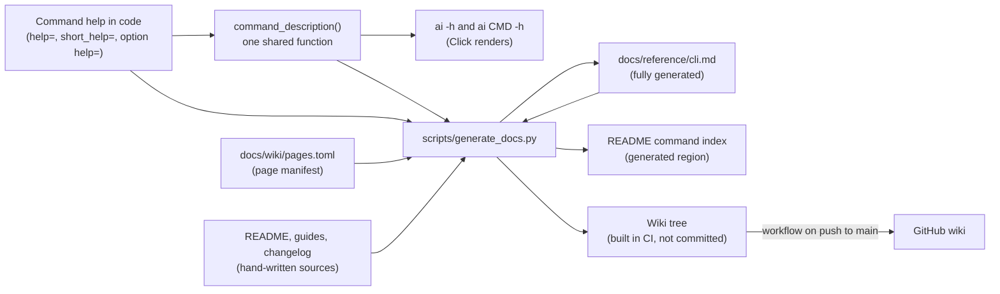

<!-- doc:region name="overview" kind="replaceable" -->

# Single-source CLI help, CLI reference and wiki pages — Design Document

## Founding Ask Coverage

The originating request was captured verbatim in a private system of record and verified by
content digest before this design was written. It is not reproduced here because it includes
private operational metadata. This index is non-authoritative; the captured request governs.

| Authoritative raw entry | Coverage and disposition |
|---|---|
| Originating request: "why does the `ai -h` not show the full descriptions for each command?" | Answered in [Problem Statement](#problem-statement); fixed by [Help rendering](#help-rendering) and [D-2](#d-2) |
| Originating request: "are these all the options (both short and long option names, it should show both)?" | Answered in [Problem Statement](#problem-statement): `ai -h` lists only the root options, and every one of the 227 visible options in the tree already has both forms. The generated reference lists both forms of every option of every command ([CLI reference document](#cli-reference-document)) |
| Originating request: update the CLI usage documentation and the help message from a shared source, enforced to stay aligned | [D-1](#d-1) (the source), [D-3](#d-3) (the canonical document), [D-4](#d-4) (the generator), [D-5](#d-5) (enforcement); Phases 1 and 2 |
| Originating request: update the project wiki with everything about this repository, generated from a single source where possible | [D-6](#d-6) and [Wiki pages](#wiki-pages); Phase 3 |
| Originating request: auto-generate canonical Markdown, CLI usage docs, help and the wiki, programmatically where possible and with an LLM only where needed | [D-7](#d-7): every published artifact is a deterministic render of committed sources; an LLM drafts only prose that cannot be derived, and that prose lands in a source file under review |
| Originating request: research open-source packages and tools for programmatic and agentic documentation generation | [📄 ai-cli-utils/docs/research/cli-docs-generation-tools.md](../research/cli-docs-generation-tools.md) |
| Originating request: a hosted documentation website for the owner's open-source repositories, deferred until later | [Website feed](#website-feed) records how this design feeds it |
| Originating request: link task records to GitHub issues and Projects, template-standard, kept in sync and rolled out with each wiki | Not dropped: the request itself directs this work into separate epics in the owner's private task store, where it is filed and tracked (measured 2026-11-11: one open parent epic with three open sub-epics, for the template-standard GitHub Project and issue setup, the two-way sync with `external_ref`, and the rollout with each repository's wiki). It is not part of this design; the wiki generator here is written so a template can reuse it ([Integration](#integration)) |
| Originating request: GitHub Discussions for public repositories, standard configuration and first post | Not dropped: the request directs it into its own epic in the same private task store, where it is filed and tracked (measured 2026-11-11: one open epic), and says "we can worry about the discussions feature later". It is not part of this design |

**Status:** DRAFT

**Created:** 2026-11-11

**Research:** [📄 ai-cli-utils/docs/research/cli-docs-generation-tools.md](../research/cli-docs-generation-tools.md)

## Table of Contents

- [Executive Summary](#executive-summary)
- [Summary for a wide audience](#summary-for-a-wide-audience)
- [Problem Statement](#problem-statement)
- [Design Overview](#design-overview)
- [The generation pipeline](#the-generation-pipeline)
  - [The source](#the-source)
  - [Help rendering](#help-rendering)
  - [CLI reference document](#cli-reference-document)
  - [README command index](#readme-command-index)
  - [Wiki pages](#wiki-pages)
  - [Enforcement](#enforcement)
  - [Where an LLM fits](#where-an-llm-fits)
  - [Website feed](#website-feed)
- [Data Model](#data-model)
- [Integration](#integration)
- [Implementation Phases](#implementation-phases)
  - [Phase 1: Full command descriptions in help](#phase-1-full-command-descriptions-in-help)
  - [Phase 2: Generated CLI reference and drift check](#phase-2-generated-cli-reference-and-drift-check)
  - [Phase 3: Generated wiki and its publication](#phase-3-generated-wiki-and-its-publication)
- [Implementation Audit](#implementation-audit)
- [Risks and Mitigations](#risks-and-mitigations)
- [Design Decisions](#design-decisions)
  - [Decision Summary](#decision-summary)
  - [Decision Details](#decision-details)
  - [D-1: The single source of command text](#d-1)
  - [D-2: How `ai -h` shows full descriptions](#d-2)
  - [D-3: Shape of the canonical CLI usage document](#d-3)
  - [D-4: Generator implementation](#d-4)
  - [D-5: How drift is caught](#d-5)
  - [D-6: Wiki source and publication](#d-6)
  - [D-7: The role of an LLM](#d-7)
  - [D-8: Commands that parse their own arguments](#d-8)
- [Open Questions](#open-questions)
- [Approval Log](#approval-log)

## Executive Summary

This design makes the help text written beside each command in the code the only place a command's
summary, full description and options are written down. Three things are generated from it: the
`ai -h` command list, a canonical CLI reference document in the repository, and the project's
GitHub wiki, which also carries the README and every other document in the repository. The `ai -h` list stops cutting
text off with "..." and shows each command's complete help description. A test fails whenever the committed reference
or README index differs from what the code would generate, so they cannot drift apart unnoticed,
and a GitHub Actions workflow republishes the wiki on every push to `main`. No LLM runs in the
generation path: an LLM may draft missing help text or guide prose, but that text is committed to a
source file and reviewed like any other change. A hosted documentation website is out of scope;
the generated Markdown is plain enough to feed one later.

## Summary for a wide audience

`ai -h` now prints every command's complete description instead of a truncated summary. A new page,
`docs/reference/cli.md`, lists every command with its usage line, its description and every option
in both its short and long form. That page and the README's command list are generated from the
code, so they always match what `ai <command> -h` prints. The project wiki is rebuilt from the
repository's own docs on every merge to `main`. Contributors change a command's help in the code
and run one script; they never edit the generated files by hand. The first wiki page has to be
created once in the GitHub web interface before publishing can start.

## Problem Statement

`ai -h` lists 52 commands and cuts most of their summaries off with "...". Click builds each row
from the first sentence of the command's help and shortens it to fit
`formatter.width - 6 - len(longest name)` columns. The formatter width is 78 on any terminal at
least 80 columns wide (80 minus a two-column margin), and the longest visible name,
`clear-restart-request`, is 21 characters, so every summary is cut at 51 characters. No command in
the tree sets `short_help`, which is the one field Click prints without shortening (measured
2026-11-11 against Click 8.5.0; [research § 1](../research/cli-docs-generation-tools.md#1-why-ai--h-truncates)).

On options: `ai -h` shows only the options of the root command. Each command's own options appear
under `ai <command> -h`. Across the whole tree there are 227 visible options and every one has
both a short and a long form; `tests/test_cli_option_forms.py` already enforces that. Nine visible
subcommands under `ai sessions` have no help text at all, so they print an empty summary. Three
commands, `ai ps`, `ai layout` and `ai sync`, parse their own arguments, so their actions and flags
are not in that count and not in any help screen: `ai ps -h` runs the process listing and
`ai sync -h` fails ([D-8](#d-8)).

The written documentation has drifted from the code. `docs/tools/ai-cli-usage.md` names 28
of the 52 top-level commands and carries hand-copied flag tables. The README's Usage section is
hand-written. Nothing checks either against the code. The wiki is enabled but empty: its git
repository does not exist yet, since `git ls-remote` on `<repo>.wiki.git` answers "Repository not
found" (measured 2026-11-11), and GitHub creates it only when the first page is saved in the web
interface.

## Design Overview

**Status:** implemented in all three phases; the live wiki publication is verified after merge.

What was built, and where it differs in detail from the sections below:

- `src/ai_cli/cli_help.py` holds `command_description()`, `command_summary()` and `HelpGroup`.
  `command_description()` asks Click's own `format_help_text` to write into a formatter so wide
  that no ordinary paragraph wraps, then removes the indentation. Every Click rule (cleanup, the
  `\f` cut, `\b` paragraphs, the deprecation label) is applied by Click itself, and the function
  touches no private API. Each ordinary paragraph comes back as one line; a `\b` paragraph keeps
  its lines. `command_summary()` is `get_short_help_str` with an unbounded limit.
  `HelpGroup.format_commands` puts the `\b` marker back on multi-line paragraphs before
  `write_dl`, so the help list keeps those line breaks too. `HelpGroup.group_class` is
  `HelpGroup`, so `@group.group()` inherits it; `_ChiefAliasGroup` and the standalone
  `ai sessions` group subclass or name it, and a tree-walk test fails on any group that does not.
- `ai ps` is a group that lists when given no command, with `clean` and `cron` subcommands. All
  three forms accept `-f/--force` and `-r/--refresh`, as the hand parser did. A flag given before
  the action (`ai ps -f clean`) is a usage error rather than a silent switch to a force-kill,
  since that form used to list. `ai layout` is a group whose `resolve_command` sends any first
  argument that is not one of its commands to a hidden apply command, so the reserved names stay
  exactly `list`, `validate` and `profiles`. `ai sync` is a group of its seven actions. Every
  command calls the unchanged implementation (`process_hygiene.cmd_ps`,
  `layout.run_layout_command`, the `sync_*` functions) with the long spelling of each flag the
  user gave, and the push and pull parity rows also check that the unchanged `_parse_flags`
  reads the new list exactly as it read the typed one. The new short forms are
  `ai sync pull -p`, `ai sync watch -a` and `ai sync watch -v`.
- `scripts/generate_docs.py` is the generator; `scripts/wiki_build.py` is the wiki builder it
  imports. The reference's usage line is the command path plus `collect_usage_pieces`, unwrapped;
  option cells are `get_help_record` text. A bare `<word>` outside a code span is written as
  `&lt;word>`, since the rendered page would otherwise drop it as an HTML tag. Click caches a
  command's help option from the first context it sees, so every context the generator and the
  tests build carries the command's own context settings; a bare context leaves `-h`
  unrecognised for the rest of the process.
- The README's Usage section opens with a "Command index" subsection holding the markers. The
  docs-example test reads `ai ...` lines in fenced blocks, accepts `[-x]`, `-x/--long` and
  `-x|--long` spellings, skips `<placeholder>` tokens, and treats an unknown option as provider
  pass-through only directly on `c`, `g`, `p` or `cx`. The per-line exemption marker is
  `# docs-example: skip`; three lines carry it (two configured-alias examples and the internal
  fast path). The test found two invented `ai ps` options in the hand-written docs, now fixed.
- Wiki manifest: a page may also set `preamble = true` to include the text before the first `##`
  heading, so Home keeps the README's title, badges and introduction. A file split into section
  pages must have every `##` section selected by some page, or the build names the section no
  page selects, so a README section cannot drop out of the wiki unnoticed. The generated
  `cli-reference` page claims `docs/reference/cli.md`, so the reference is not published twice.
  Group member pages are named from the repository path with `/` replaced by `-`; the builder
  rejects any two names that would map to the same wiki file. A link that leaves the repository
  (`../` past the root) keeps its text and loses its target, because the wiki cannot resolve it.
  Every page ends with a line naming its source; `_Footer.md` says the wiki is generated.
- The workflow has two jobs. `build` checks out `refs/heads/main` with a read-only token, runs
  the builder with `--check` (so a stale reference on `main` fails instead of publishing) and
  uploads the tree. `publish` holds `contents: write`, runs only `actions/download-artifact` and
  git, and never executes repository code or a third-party action, which is the strictest reading
  of Risk 6: the builder needs `astral-sh/setup-uv`, and that action never sees the write token.
  Both jobs require `github.ref == 'refs/heads/main'`. A missing wiki repository is detected with
  an anonymous `git ls-remote` before any token is used.
- Found while implementing: 289 code blocks in 42 Markdown files were closed with a fence that
  carried an info string, which CommonMark does not accept as a closing fence, so the block ran
  on into the following prose. They were fixed in their own commit before the wiki started
  publishing those files.

## The generation pipeline



### The source

Each command's text lives where it lives today, in the Click decorators: `help=` (or the
callback's docstring) for the description, an optional `short_help=` for the summary, and each
option's `help=`, `metavar`, default and flags. This design adds no second file for command text.
The complete description of a command is computed by one function,
`command_description(command, context)`, that both the help formatter and the document generator
call. It applies Click's help-text cleanup and formatting rules to the full `help` value (or the
callback docstring), including `\f` and `\b` handling. `command_summary(command)` remains a compact
index label: explicit `short_help` when set, otherwise the first sentence of the first paragraph.

### Help rendering

Every group in the tree uses one shared `click.Group` subclass whose `format_commands` writes each
row from `command_description()` instead of Click's shortened text. Click's `write_dl` preserves
and wraps the complete description onto following lines, so no sentence or paragraph is omitted.
The root context sets `max_content_width` to 100
so a terminal wider than 80 columns uses up to 100; an 80-column terminal renders as today, minus
the truncation. The existing `_ChiefAliasGroup` becomes a subclass of the shared class so its
alias routing is unchanged.

### CLI reference document

`docs/reference/cli.md` is generated in full and starts with a notice naming the command that
regenerates it. It holds an index table of every visible command (path and summary), then one
section per command in tree order with: the usage line Click prints, the full description, an
arguments list, and an options table. The options table has columns for the short form, the long
form, the value placeholder and the description, and the description text is the same help record
Click prints under `ai <command> -h`, including `[default: ...]` and `[required]` markers. Hidden
commands and hidden options are left out, as `-h` leaves them out.

`docs/tools/ai-cli-usage.md` stays as the narrative guide (design notes, behaviour, configuration
walk-throughs). Its title becomes a guide title, it links to the reference at the top, and its
hand-copied flag tables are replaced by links to the matching reference sections, so no option is
written down by hand anywhere.

### README command index

The README's Usage section gains a generated region between `<!-- cli-index:begin -->` and
`<!-- cli-index:end -->` markers holding the same index table as the reference, linking each
command to its reference section. The generator rewrites only the bytes between the markers.

### Wiki pages

The wiki is a separate git repository (`<repo>.wiki.git`). A committed manifest,
`docs/wiki/pages.toml`, lists each wiki page, its order in the sidebar, and its source: a whole
repository file, named `##` sections of a file, or the generated CLI reference. The generator
builds the wiki tree from the manifest into a directory: one `.md` file per page, a generated
`_Sidebar.md` and a `_Footer.md` stating that the page is generated and naming its source path, so
a reader editing in the wiki UI knows the edit will be overwritten.

Links are rewritten as the pages are built. A link to a file or section that is itself a wiki page
becomes a wiki link to that page and anchor. Any other repository-relative link becomes an absolute
`https://github.com/<owner>/<repo>/blob/main/<path>` link, and a relative image becomes a raw
content link, so nothing in the wiki points at a path the wiki does not have. The owner and repo
come from `GITHUB_REPOSITORY` in CI or a `-R/--repository` argument locally; the source tree never
names them.

The wiki carries everything in the repository's documentation, in two parts. The user part
comes first in the sidebar: the README (split into Home, Installation, Quick Start, Usage and
Configuration pages), the generated CLI reference, the narrative CLI guide, the guides and tools
docs, the architecture doc, CONTRIBUTING, SECURITY and the CHANGELOG. The project-records part
follows: one wiki page for every other tracked Markdown file anywhere in the repository, every
other tracked file under `docs/` and any other tracked document such as `LICENSE` (designs, plans, research, audits, bug write-ups, procedures,
analyses, linked text artifacts, reference configuration and the rest), grouped by folder. A
non-Markdown document is rendered in a fenced block whose language comes from its suffix. Each
group has a generated index page that lists its pages with titles selected by one deterministic
chain: a non-empty frontmatter `title`, then the first `#` heading, then the normalized filename.
Page names are derived from the repository path, so two files with the same basename never collide
in the wiki's flat namespace.

The builder derives the coverage universe from `git ls-files`, normalizes each entry to a
repository-relative POSIX path, and includes every tracked file; the manifest cannot narrow it. One
manifest matcher handles group and exclusion patterns. A slashless pattern matches the basename at
any depth. In a pattern containing a slash, `*` matches within one path component and `**` matches
zero or more complete components. Matching is case-sensitive on every platform.

Assignment runs in a fixed order, so every file lands in exactly one place. First, explicit pages
claim their sources. Then groups, in manifest order, claim the files they match that are still
unclaimed; the `docs/**` group therefore publishes every file under `docs/`, whatever its suffix (a
`.toml` reference file, an invariant register, an audit receipt). The builder then freezes the
remaining unclaimed paths as the exclusion candidate set. Every exclusion is matched and validated
only against that same set, never against the full tracked inventory or a progressively reduced
set. An exclusion is a pattern for a class of non-documents outside `docs/`, with a reviewable
reason: Python and shell source anywhere (`*.py`, `*.sh`, `py.typed`), tests (`tests/**`), hooks
(`.githooks/**`), configuration and data outside `docs/` (`*.toml`, `*.yaml`, `*.yml`, `*.json`,
`*.json5`, `*.lock`, `.gitignore`-style dotfiles), and binary or generated assets (`assets/**`,
`demo/**`, `src/ai_cli/data/**` non-Markdown files). If an exclusion's candidate-set matches include
a Markdown file or a path under `docs/`, the builder rejects it; this indicates that the required
publication group failed to claim a document. A pattern such as `*.toml` may also match a claimed
`docs/` path in the full inventory without error because claimed paths are not exclusion candidates.
A document outside `docs/` that is not Markdown and that no exclusion class describes, such as the
top-level `LICENSE` or the documented configuration example `.env.example`, is then neither claimed
nor excluded, and the coverage test fails naming it until the manifest gives it a page. The initial
manifest publishes both. Deciding coverage this way, with publication taking precedence and
exclusions limited to named non-document classes, means a new document cannot be left out because
nobody thought to name its location.

A workflow, `.github/workflows/wiki.yml`, runs on every push to `main` and allows manual dispatch
only as a retry for `refs/heads/main`. The publication job has an explicit
`github.ref == 'refs/heads/main'` condition and checks out the trusted main ref before executing the
builder. It builds the tree, checks out the wiki repository with the workflow token
(`permissions: contents: write`), replaces its contents with the built tree, and commits and pushes
only when something changed. GitHub creates the wiki repository only when the first page is saved
in the web interface, so until that one-time human step the workflow fails with a message naming
it. Whether the default workflow token can push to this repository's wiki is an unverified
capability until the first live run; publication stops and requests maintainer direction if it
cannot, without silently adding another credential.

### Enforcement

A pytest module regenerates the reference and the README region in memory and compares them with
the committed files; a mismatch fails with a unified diff and the regenerate command. A second test
renders `ai -h` and every group's help at width 80 and asserts that each command's complete
`command_description()` appears and no row ends in "...". A third builds the wiki tree into a
temporary directory and asserts that every manifest source exists, every selected section exists,
every tracked documentation source is published or exactly excluded with a reason, all three title
fallbacks work, and every link in the output resolves. A fourth reads every `ai ...` example in the
hand-written docs' code blocks and
fails when one names a command or option the tree does not have, so narrative usage text cannot
drift either. These run in the existing CI on Linux, macOS and Windows. A pre-commit hook runs
`generate_docs.py --check`, so a contributor learns before pushing.

### Where an LLM fits

No LLM runs during generation, in CI or in the wiki workflow. Everything published is a
deterministic function of committed files. An LLM is useful at authoring time: drafting the
missing help text for the nine undocumented `ai sessions` subcommands, tightening an over-long
summary, or drafting a guide page. That text is written into the source file (the decorator, the
README, a guide), and goes through the same review and tests as any code change. The research found
that an ungrounded LLM invents or misnames a large share of repository-specific facts, so options,
defaults, usage lines and command lists always come from the code.

### Website feed

The hosted website is out of scope. Everything this design produces is CommonMark plus GitHub
tables in `docs/`, which MkDocs, Zensical, Sphinx with MyST, Docusaurus and Starlight all read
without conversion. A later site can use `docs/reference/cli.md` as its CLI page and
`docs/wiki/pages.toml` as its navigation, and the repository's website field can then point at it.

## Data Model

The wiki manifest, `docs/wiki/pages.toml`:

```toml
# Order of [[page]] entries is the sidebar order.
[[page]]
name = "Home"                 # wiki page name; file is Home.md
source = "README.md"
sections = ["What it does", "Features"]   # optional: named ## sections, in this order

[[page]]
name = "CLI Reference"
generated = "cli-reference"   # rendered by the CLI reference generator, not read from a file

[[page]]
name = "Changelog"
source = "CHANGELOG.md"       # whole file

# Project records: one page per matching file, grouped under a generated index page.
[[group]]
name = "Design documents"     # index page name and sidebar heading
glob = "docs/designs/**/*.md"

[[group]]
name = "Other Markdown"       # catch-all for Markdown no page or earlier group covers
glob = "**/*.md"

[[group]]
name = "Other documentation artifacts"  # catch-all for remaining docs/ files
glob = "docs/**/*"

[[page]]
name = "License"
source = "LICENSE"            # a document with no suffix; rendered as text

[[page]]
name = "Configuration Example"
source = ".env.example"       # documented environment example; rendered as text

# Non-document classes, applied only to files no page or group claimed; never Markdown, never docs/.
[[exclude]]
pattern = "*.py"
reason = "Python source, documented through the generated CLI reference"

[[exclude]]
pattern = "*.toml"
reason = "Project configuration outside docs/, not reader documentation"
```

Each page has `name` and exactly one of `source` or `generated`; `sections` is valid only with
`source`. Each group has `name` and `glob`; a file matched by an explicit page or an earlier group
is not repeated by a later one. Group globs use the manifest matcher against the tracked-file
inventory, including dot-directories. Markdown sources render as Markdown; other UTF-8 sources
render in a fenced block. Each exclusion has a `pattern` naming a class of non-document files and a
non-empty `reason`; it uses the same matcher only against the fixed unclaimed candidate set. A
Markdown file is a document by definition and everything under `docs/` is published, so any such
path that remains an exclusion candidate is a manifest error. The generator rejects an unknown key,
a duplicate name, a missing source file, a missing section, an unknown `generated` value, a group
whose pattern matches no tracked file, an exclusion whose pattern matches no candidate, an empty
exclusion reason, and an exclusion whose candidate-set matches include a Markdown file or a path
under `docs/`, naming the entry.

The description, summary and generator interfaces:

```text
command_description(command, context) -> str
    complete Click-formatted help text, including paragraph structure, else "".

command_summary(command) -> str
    short_help (cleaned) if set, else first sentence of the help's first paragraph, else "";
    used only in compact indexes, never as the root help description.

render_reference(root_group) -> str          # docs/reference/cli.md content
render_index(root_group, link_base) -> str   # index table, used by the reference and README
build_wiki(manifest, repo_root, out_dir, repository) -> list[Path]

scripts/generate_docs.py
    (no options)            rewrite docs/reference/cli.md and the README region
    -c, --check             write nothing; exit 1 with a diff when either is stale
    -w, --wiki-out DIR      also build the wiki tree into DIR
    -R, --repository O/R    owner/repo for absolute links (default: $GITHUB_REPOSITORY)
```

## Integration

The generator imports the CLI's root group directly and needs no network, configuration file or
installed console script. The wiki builder reads only tracked files, and its coverage universe is
every tracked file (`git ls-files`). The
public-hygiene tests scan
every source the wiki publishes and specifically reject private workflow metadata in public design
documents, so the wiki exposes nothing the repository does not already publish. The project
template can later lift the wiki builder and workflow unchanged for other repositories; that
rollout is outside this design.

## Implementation Phases

<!-- doc:ac-rules:mirror:begin -->
- Every AC is independently testable — a test can fail if only this AC is violated.
- Every AC is falsifiable — "works correctly" is not an AC.
- Use EARS as the default for textual behavioral ACs: `When <trigger>, the system shall <response>` (event-driven); `While <state>` / `Where <feature>` (state-driven / optional); `If <condition>, then the system shall <response>` (unwanted-behavior / failure path). When a decision table, state machine, formula, executable Gherkin, property, or contract expresses the behavior more clearly, wrap it in an `<!-- ac-format: <value> ... --> ... <!-- /ac-format -->` scope (`decision-table` / `state-machine` / `formula` / `gherkin` / `property` / `contract`; unmarked ACs default to `ears`). Full per-format `ac-format` schemas are normative at `task-authoring-standards.md` § Per-Format AC Schemas — **always check that live source directly for the current schemas before relying on this reminder; this mirrored block itself can drift out of date and must never be treated as authoritative on its own.**
- At least one failure-path AC per public function changed — EARS `If <condition>, then the system shall …`, or the marked format's own negative-path convention (a decision table's infeasible-combination row, a state machine's invalid-transition row, a formula's invalid-input row).
- Replacement/refactor tasks: inventory the existing behaviors, then a parity AC for each (preserved, or intentionally dropped + reason).
<!-- doc:ac-rules:mirror:end -->

### Phase 1: Full command descriptions in help

- **Scope:** the shared description and summary functions, the shared group class, help text for the commands
  that have none, and Click declarations for the three self-parsing commands.
- **Deliverables:**
  - Files created: `src/ai_cli/cli_help.py`
  - Files modified: `src/ai_cli/main.py`, `src/ai_cli/session_commands.py`,
    `src/ai_cli/name_commands.py` and any other module that declares a group,
    `src/ai_cli/process_hygiene.py` and `src/ai_cli/layout.py` where their entry points change,
    `CHANGELOG.md`
  - Tests added: `tests/test_cli_help.py`, parity tests for `ps`, `layout` and `sync`
- **Tasks + acceptance criteria:**
  - **T-1.1 Shared description, summary and group class**
    - [ ] When `ai -h` is rendered at width 80, the system shall print every visible top-level
      command's complete `command_description()` with every sentence and paragraph, wrapped where
      needed, and no command row shall end in "...".
    - [ ] When any visible group's help (`ai <group> -h`) is rendered at width 80, the system shall
      print each visible subcommand's complete `command_description()`.
    - [ ] When a command sets `short_help`, `command_summary()` shall return that text cleaned of
      indentation for compact generated indexes; the help list shall still print the complete
      `command_description()` rather than substituting the summary.
    - [ ] If a command has no help text, then `command_description()` and `command_summary()` shall
      return an empty string rather than raise.
    - [ ] When the terminal is 120 columns wide, the system shall render help at a content width of
      100.
    - [ ] When a configured chief-of-staff command alias is invoked, the system shall route it to
      `ai cos` exactly as before (parity with `_ChiefAliasGroup.resolve_command`).
    - [ ] When `ai` runs with no arguments, the system shall print the same help text that `ai -h`
      prints (parity).
  - **T-1.2 Help for undocumented commands**
    - [ ] When the tree is walked, every visible command and group shall have a non-empty
      `command_summary()`; a test lists any that do not.
  - **T-1.3 Self-parsing commands declared in Click ([D-8](#d-8))**
    - [ ] When `ai ps -h`, `ai layout -h` or `ai sync -h` runs, the system shall print Click help
      listing that command's actions and options and exit 0 without performing any action.
    - [ ] When one of the forms in the inventory below is used, the system shall call the same
      implementation with the same values as before, with one test per row through the CLI entry
      point. The inventory is every action and flag token the current hand parsers recognize,
      read from their source (measured 2026-11-11 at `d301960c`: `process_hygiene.cmd_ps`,
      `layout.run_layout_command`, `main.cmd_sync`, and in `sync.py` `_parse_flags`,
      `sync_resolve` and `sync_watch`), not from any document:

      | Command | Action and arguments | Flags recognized today | Flag forms after the change |
      |---|---|---|---|
      | `ai ps` | none, `clean`, `cron` | `-f`/`--force`, `-r`/`--refresh` | unchanged |
      | `ai layout` | `list`, `validate <name>`, `profiles <name>`, `<name>` (any other first argument applies that layout) | none (`-h`/`--help` prints usage) | unchanged |
      | `ai sync push` | none | `-m`/`--memories-only`, `-n`/`--dry-run`, `-v`/`--verbose`, `-f`/`--force` | unchanged |
      | `ai sync pull` | none | `-m`/`--memories-only`, `-n`/`--dry-run`, `-v`/`--verbose`, `-f`/`--force`, `--prefer-remote` | `--prefer-remote` gains a short form; the long spelling is kept |
      | `ai sync conflicts` | none | none | unchanged |
      | `ai sync resolve` | none | `-n`/`--dry-run`, `-v`/`--verbose` | unchanged |
      | `ai sync watch` | none | `--auto`, `--verbose` | each gains a short form; the long spellings are kept |
      | `ai sync cleanup` | none | `-n`/`--dry-run`, `-v`/`--verbose` | unchanged |
      | `ai sync repair-worktree` | `<project> <worktree>` | `-n`/`--dry-run`, `-v`/`--verbose` | unchanged |

      The short forms chosen for the three long-only flags must not collide with another option of
      the same command, and the existing option-form test then covers them.
    - [ ] When the repository's own callers invoke these commands (measured: `ai sync watch --auto`
      in the session script template, `src/ai_cli/session_script.py`; the `ps cron` path in
      `src/ai_cli/process_hygiene.py`; and any other found by searching `src/`, `scripts/`,
      `.githooks/` and `config/` for `ai ps`, `ai layout` and `ai sync`), each exact argument list
      shall be a parity test row, so a caller's form cannot break without a named failure.
    - [ ] Before converting a parser, the implementer shall re-read its source on the base commit and
      confirm the inventory row matches; a token found there and missing from the table is added to
      the table and its parity test, never dropped silently. The parity tests carry the table as
      parametrized data, so each row, every spelling included, fails on its own if the converted
      command stops accepting it.
    - [ ] When `ai layout <name>` is used and `<name>` is not a reserved action, the system shall
      call `cmd_layout_apply(name)`; reserved action names shall continue to select their action.
    - [ ] If `validate`, `profiles`, or `repair-worktree` lacks a required name, then the system
      shall exit non-zero with usage text, preserving current failure behavior.
    - [ ] If an unknown action, option, or trailing token is given, then the system shall exit
      non-zero with a usage error naming it. The old acceptance of unknown `ps` flags and ignored
      trailing tokens is intentionally dropped: it was undocumented accidental tolerance, cannot
      be represented honestly in Click help, and can conceal a mistyped destructive option.
    - [ ] When the repository's own scripts and hooks invoke these commands, each invocation shall
      still parse (a test enumerates them).
  - **T-1.4 Changelog**
    - [ ] `CHANGELOG.md` `[Unreleased]` shall describe the complete root-help descriptions and the working
      `-h` on `ai ps`, `ai layout` and `ai sync`.
- **Exit gate:** `uv run ruff check src/ tests/`, `uv run ruff format --check src/ tests/`,
  `uv run pyright src/` and `uv run pytest` pass; `ai -h` read by eye shows no "...".

### Phase 2: Generated CLI reference and drift check

- **Scope:** the reference renderer, the README region, the generator script, its tests, the
  pre-commit hook, and the doc updates that point at the generated file.
- **Deliverables:**
  - Files created: `scripts/generate_docs.py` (or a package module it wraps), `docs/reference/cli.md`
    (generated), `tests/test_cli_docs.py`
  - Files modified: `README.md` (index region), `docs/tools/ai-cli-usage.md` (guide title, link to
    the reference, flag tables replaced by links), `docs/tools/README.md`, `docs/README.md` if it
    indexes reference docs, `CLAUDE-full.md` and `AGENTS.md` (the "update docs when shipping"
    instruction now says to regenerate), the `docs/tools/ai-cli-usage.md` pointer comment in
    `src/ai_cli/main.py`, `.pre-commit-config.yaml`, `CHANGELOG.md`
- **Tasks + acceptance criteria:**
  - **T-2.1 Reference renderer**
    - [ ] When the reference is generated, it shall contain one section per visible command in
      tree order, each with the usage line Click prints for that command, the full help text, its
      arguments, and an options table whose rows are the help records Click prints for that
      command's visible options.
    - [ ] When an option has both a short and a long form, its row shall show each in its own
      column.
    - [ ] When a command's help contains a `\f` marker or a `\b` paragraph, the reference shall
      leave out the text after `\f` and keep the `\b` paragraph's line breaks, as `-h` does (the
      description goes through Click's own help formatting, never raw `command.help`).
    - [ ] When a command or option is hidden, the reference shall not mention it.
    - [ ] When the reference is generated twice from the same tree, the outputs shall be
      byte-identical, and they shall not depend on the terminal width, the user's configuration or
      the operating system: the generator pins the formatter width and writes LF line endings on
      every platform; the repository's `.gitattributes` already forces `eol=lf`, so a Windows
      checkout compares equal.
    - [ ] When the reference is generated, its index table shall list every visible command path
      with its `command_summary()`, linking to its section.
  - **T-2.2 README region**
    - [ ] When the generator runs, it shall replace only the bytes between the `cli-index` markers
      in `README.md` and leave every other byte unchanged.
    - [ ] If either marker is missing or the markers appear more than once, then the generator
      shall exit non-zero naming the file and write nothing.
  - **T-2.3 Generator and check mode**
    - [ ] When `generate_docs.py -c` runs on an up-to-date tree, it shall write nothing and exit 0.
    - [ ] If a command's help text changes and the reference is not regenerated, then
      `generate_docs.py -c` shall exit 1 and print a unified diff and the command that fixes it.
    - [ ] When the pytest suite runs with a stale committed reference or README region, a test
      shall fail with the same diff.
    - [ ] When `generate_docs.py -h` runs, every option shall show both a short and a long form.
  - **T-2.4 Examples in hand-written docs name real commands and options**
    - [ ] When the test suite runs, every shell example line beginning with `ai ` inside a fenced
      code block in `README.md`, `docs/tools/*.md` and `docs/guides/*.md` shall resolve to a
      visible command path. Each option token shall be classified as a locally declared option,
      an intentional provider pass-through on `c`, `g`, `p`, or `cx`, or invalid; locally declared
      options shall accept both spellings, and pass-through tokens shall be preserved without being
      misreported as local options.
    - [ ] If an example names a command or option that does not exist, then the test shall fail
      naming the file, the line and the unknown token.
    - [ ] When an example uses a provider pass-through option, the test shall record that
      classification and shall not require the provider option to be declared on the launcher;
      when the same token appears on a command that does not allow pass-through, the test shall
      classify it as invalid.
    - [ ] Where an example is deliberately invalid or illustrative, a per-line marker comment shall
      exempt it, and the test shall report how many lines are exempt.
  - **T-2.5 Hand-written docs point at the generated reference**
    - [ ] When `docs/tools/ai-cli-usage.md` is read, it shall link to `docs/reference/cli.md` at the
      top and contain no table that lists a command's flags.
    - [ ] The contributor instruction in `CLAUDE-full.md` and `AGENTS.md` shall name the regenerate
      command instead of asking for a hand edit of the usage doc.
- **Exit gate:** Phase 1 gate plus `uv run python scripts/generate_docs.py -c` exits 0 and the
  pre-commit hook passes on the branch.

### Phase 3: Generated wiki and its publication

- **Scope:** the manifest, the wiki builder with link rewriting, its tests, the publishing workflow.
- **Deliverables:**
  - Files created: `docs/wiki/pages.toml`, `.github/workflows/wiki.yml`, wiki builder code
    (in the generator or a module it imports), tests in `tests/test_cli_docs.py` or
    `tests/test_wiki_build.py`
  - Files modified: `CONTRIBUTING.md` (how the wiki is generated, that wiki edits are overwritten),
    `CHANGELOG.md`
- **Tasks + acceptance criteria:**
  - **T-3.1 Manifest validation**
    - [ ] If a manifest page names a missing source file, a missing `##` section, an unknown key,
      a duplicate page name, or both `source` and `generated`, then the builder shall exit
      non-zero naming the page and build nothing.
    - [ ] If a group's glob matches no file, or a group lacks `name` or `glob`, then the builder
      shall exit non-zero naming the group and build nothing.
    - [ ] If an exclusion matches no path in the fixed unclaimed candidate set, its candidate-set
      matches include a Markdown file or a path under `docs/`, or it has an empty reason, then the
      builder shall exit non-zero naming the exclusion and build nothing.
    - [ ] Given a group that claims `docs/reference/example.toml`, an unclaimed
      `config/tool.toml`, and an exclusion pattern `*.toml`, when the manifest is validated, then
      the docs file shall remain published and only the config file shall be excluded. If the group
      claim is removed, then validation shall fail naming the exclusion and the docs file.
  - **T-3.2 Page build**
    - [ ] When the wiki is built, it shall write one file per manifest page plus `_Sidebar.md` and
      `_Footer.md`, and the sidebar shall list the pages in manifest order.
    - [ ] When a page selects sections, it shall contain exactly those `##` sections in the listed
      order.
    - [ ] When a source links to a file or section published as a wiki page, the built page shall
      link to that wiki page and anchor; when it links to any other repository path, the built
      page shall link to that path on `main` on GitHub; a relative image shall become a raw content
      URL.
    - [ ] When the built tree is scanned, every relative link shall resolve to a built page, and the
      test shall fail naming any link that does not.
    - [ ] When the wiki is built, every tracked file shall be claimed by exactly one page or group,
      in the fixed order pages, then groups in manifest order, or else matched by an exclusion
      class; an exclusion never applies to a claimed file. The test shall fail naming any file that
      is neither claimed nor excluded, and shall assert that every non-Markdown file under `docs/`
      (such as `docs/reference/iterm2-defaults.toml` and an audit receipt) is published. Focused
      fixtures shall cover a top-level document with no suffix (such as `LICENSE`), Markdown in a
      hidden directory, Markdown outside `docs/`, a linked non-Markdown artifact under `docs/`, and
      the claimed-docs/unclaimed-config overlap from T-3.1.
    - [ ] When a group is built, it shall write one page per matched file, named from the file's
      repository path so that no two pages collide, and one index page listing each member page.
      The index label shall use the first non-empty value in this order: frontmatter `title`, first
      `#` heading, normalized filename. Focused fixtures shall exercise all three branches; the
      sidebar shall show the user pages first and then each group in manifest order.
    - [ ] When the wiki is built twice from the same commit, the trees shall be byte-identical.
  - **T-3.3 Publishing workflow**
    - [ ] When a commit lands on `main`, the workflow shall build the wiki and attempt to push it
      to the wiki repository with the default workflow token, committing only when the built tree
      differs from the wiki's current content.
    - [ ] When the publication job starts, it shall require
      `github.ref == 'refs/heads/main'` and check out the trusted main ref before executing any
      repository builder code; a manual dispatch on any other ref shall skip the write-capable job.
    - [ ] If the first live publication proves that the default workflow token cannot push to the
      wiki, then the workflow shall stop with a diagnostic and request maintainer direction. It
      shall not provision, request, or silently fall back to a personal token; any authorized
      credential fallback shall be designed and reviewed separately.
    - [ ] If the wiki repository does not exist yet, then the workflow shall fail with a message
      saying the first wiki page must be created once in the GitHub web interface.
    - [ ] When the workflow runs on a pull request, it shall not run at all; manual dispatch is a
      main-only retry path, not a branch-selectable publication path.
- **Exit gate:** Phase 2 gate plus the wiki tests pass on all three CI operating systems; after
  merge and the one-time first-page step, a workflow run on `main` publishes and the wiki's Home
  and CLI Reference pages read correctly in the browser (live verification).

> **Feedback Round 1:** Does the phasing feel right: too big, too small? Should anything move earlier or later?
> - <enter feedback here>

## Implementation Audit

| # | Phase | Section / Decision | Verified | Notes |
|---|-------|--------------------|---------|-------|
| 1 | N/A | Design Overview filled with concrete implementation knowledge | - [x] | [Design Overview](#design-overview) |
| 2 | Phase 1 | D-2: `ai -h` and every group list complete descriptions; no "..." | - [x] | `tests/test_cli_help.py`: one parametrized case per group at width 80, plus the 120-column content-width case |
| 3 | Phase 1 | Every visible command has a summary | - [x] | Tree-walk test; nine `ai sessions` subcommands and `ai sessions mark -c` gained help |
| 3a | Phase 1 | D-8: `ps`, `layout`, `sync` declared in Click with parity tests | - [x] | `tests/test_cli_self_parsing.py`: every inventory row and spelling, the repository callers found by search, missing-name and unknown-token failures |
| 4 | Phase 2 | D-3, D-4: reference generated, deterministic, matches `-h` records | - [x] | `tests/test_cli_docs.py` compares each section with the usage line and option records of `ai <command> -h` |
| 5 | Phase 2 | D-5: stale reference or README region fails pytest and the hook | - [x] | Drift test plus the `generate-docs` pre-commit hook (passed on the commits that touched `src/` and `docs/`) |
| 6 | Phase 2 | No hand-written flag table remains in the narrative guide | - [x] | Two tables replaced by reference links; asserted by test |
| 7 | Phase 3 | D-6: complete tracked-document inventory, title fallback, manifest, links, sidebar and footer verified | - [x] | `tests/test_wiki_build.py`, on fixtures and on this repository's own tree |
| 8 | Phase 3 | Workflow publishes on `main` only; default-token capability verified live | - [ ] | Triggers, ref guard and permissions asserted by test. The live run waits on merge and on the one-time first wiki page |
| 9 | N/A | D-7: no LLM call anywhere in generation or CI | - [x] | The generator and the wiki builder run offline from committed files; the workflow only installs dependencies and runs git |

**Audit completed:** <!-- YYYY-MM-DD; update when all items above are checked --> Open: item 8 waits on the first live run after merge.

## Risks and Mitigations

| # | Risk | Impact | Mitigation |
|---|------|--------|------------|
| 1 | Help text that differs by platform or configuration makes the committed reference differ on Windows or macOS CI | The drift test fails on one OS only | Help and defaults are static today (measured: no help string reads configuration or the environment). The determinism AC runs on all three CI systems, so a future dynamic string fails loudly where it appears |
| 2 | Contributors edit `docs/reference/cli.md` or the wiki by hand | The edit is lost on the next regeneration | The generated notice at the top of the reference and the wiki footer say so; the drift test rejects a hand edit of the reference |
| 3 | The wiki workflow fails until the first page exists or the default token's wiki capability is verified | A red run on `main` | The failure distinguishes the one-time page step from token authorization; a token failure stops for maintainer direction and never silently adds a credential |
| 4 | Complete descriptions wrap onto many lines in an 80-column `ai -h` | A substantially longer list | This is the explicit full-description requirement; wrapping preserves readability and `command_summary()` remains available for compact generated indexes |
| 5 | A future Click release changes `format_commands` or help records | Help or reference rendering changes | The override uses only public API (`get_short_help_str`, `get_help_record`, `write_dl`); tests pin the visible output, so an upgrade that changes it fails the suite |
| 6 | The wiki workflow's token can write repository contents | A compromised step could push to the repository | The job requires the main ref, checks out trusted main before running the builder, uses pinned first-party actions and no third-party action, and runs no code from pull requests or dispatched branches |

## Design Decisions

### Decision Summary

| # | Decision | Options Considered | Recommended (AI) | Chosen | Diverged? | Rationale | Status |
|---|----------|-------------------|------------------|--------|-----------|-----------|--------|
| D-1 | The single source of command text | (a) Click decorators in code, (b) a separate data file, (c) adopt click-extra | (a) | (a) | No | One place, already populated and already what `-h` prints; no new dependency | `✅ Resolved by Claude` |
| D-2 | How `ai -h` shows full descriptions | (a) shared group class prints untruncated summaries, (b) require `short_help` on every command, (c) only widen the content width, (d) print complete formatted help descriptions | (d) | (d) | No | Satisfies the literal full-description requirement from the same help text used by the generated reference | `✅ Resolved by audit fix` |
| D-3 | Shape of the canonical CLI usage document | (a) one fully generated reference plus narrative guide, (b) generated blocks inside the existing guide, (c) one generated file per command | (a) | (a) | No | Clear ownership: generated files are never hand-edited | `✅ Resolved by Claude` |
| D-4 | Generator implementation | (a) in-repo generator on Click's public API, (b) cog blocks in Markdown, (c) mkdocs-click, (d) Typer's `get_docs_for_click` | (a) | (a) | No | No new dependency or private API; same records `-h` prints | `✅ Resolved by Claude` |
| D-5 | How drift is caught | (a) pytest comparison plus pre-commit `--check`, (b) CI-only job, (c) generate at build time, never commit | (a) | (a) | No | Runs on all three CI systems and locally before push | `✅ Resolved by Claude` |
| D-6 | Wiki source and publication | (a) manifest over repo docs, built and pushed by a first-party workflow, (b) same build, pushed by a third-party wiki action, (c) commit built pages and sync them, (d) hand-maintained wiki | (a) | (a) | No | Single source per page, nothing generated committed twice, no third-party code holds the write token | `✅ Resolved by Claude` |
| D-7 | The role of an LLM | (a) authoring aid only, output committed to sources, (b) scheduled LLM regeneration opening pull requests, (c) an external LLM-generated wiki | (a) | (a) | No | Every published fact stays derivable; prose stays reviewable | `✅ Resolved by Claude` |
| D-8 | Commands that parse their own arguments | (a) declare their actions and options in Click, (b) keep the hand parsers and add static help text the generator reads | (a) | (a) | No | Puts their options in the single source and makes their `-h` work | `✅ Resolved by Claude` |

### Decision Details

<a id="d-1"></a>

#### D-1: The single source of command text — `✅ Resolved by Claude: (a) Click decorators in code`

**Context.** The ask wants one shared source from which both `ai -h` and the canonical usage doc
are generated. Click already renders `-h` from the decorators, and 87 of 96 visible commands
already carry help text there.

##### (a) Click decorators in code

**Pros:**

- The text sits beside the code it describes, so a change to a command and its help land in the
  same diff.
- `-h` already renders from it; only the document side needs a renderer.
- No new file format, loader or dependency.

**Cons:**

- Long help strings make decorators verbose.
- Prose for the narrative guide cannot live in a decorator.

##### (b) A separate data file

A TOML or YAML file keyed by command path holds every summary, description and option help;
decorators read it at import.

**Pros:**

- All user-facing text in one file, easy to review or translate.

**Cons:**

- A second place that must agree with the declared options; it needs its own drift test.
- Every invocation parses the file, including the latency-sensitive internal fast path.
- Moves the text away from the code that changes with it.

##### (c) Adopt click-extra

**Pros:**

- Ships Markdown help output, a tree view and help formatting in one package.

**Cons:**

- GPL-2.0-or-later as a runtime dependency of an MIT-style package, which needs an owner decision.
- A framework migration of every command, on a major line that released four times in one week.

##### Recommendation

> **Decision:** ✅ Resolved by Claude (2026-11-11); confidence: high — (a) Click decorators in code.
<!-- decision-record: chosen-option=(a); ai-family=claude; ai-model=us.anthropic.claude-opus-5-5; ai-effort=default; ai-profile=coordinator -->
<!-- decision-lineage: decision-id=single-source-cli-docs/D-1; decision-topic=single-source-of-command-text; governs=design:single-source-cli-docs; normalized-proposition=click-decorators-are-the-only-source-of-command-text; applicability=ai-cli-command-tree; outcome-id=decorators-as-source; relation=different-question; related-decision-id=; supersedes=; approval-log-decision-id=; approval-actor=; approval-date=; approval-commit= -->

**Authority test.** Gate 0 passes: the ask's "shared source" is kept and made exact; nothing it
names is dropped. Gate A does not fire: recording the choice is neither destructive nor outward.
Gate B does not fire: this is fresh authoring. Gate C does not fire: no ratified requirement
changes. Gate D permits self-resolution: the choice is reversible (text can move to a data file
later), and the facts behind it were measured.

The verbosity Con is accepted: help text is already in decorators today, and this design adds no
length. The narrative-prose Con is handled by keeping narrative in Markdown sources ([D-3](#d-3)),
which the wiki also publishes.

---

<a id="d-2"></a>

#### D-2: How `ai -h` shows full descriptions — `✅ Resolved by audit fix: (d) print complete formatted help descriptions`

**Context.** Click cuts each summary to 51 columns at the default width. The fix must apply to
every group, including future ones.

##### (a) Shared group class prints untruncated summaries

**Pros:**

- One override fixes all 96 visible commands with no text edits.
- The same `command_summary()` feeds compact reference indexes.
- Uses only public Click API.

**Cons:**

- Every group must use the class; a new group declared with plain `click.group` would regress.
- Long first sentences wrap to two or three lines.

##### (b) Require `short_help` on every command

**Pros:**

- Uses Click's own untruncated path with no override.
- Forces a deliberately written one-line summary.

**Cons:**

- 96 new strings, duplicating the first sentence of most help texts.
- A command added later without one is truncated again.

##### (c) Only widen the content width

**Pros:**

- One setting.

**Cons:**

- Does nothing on an 80-column terminal, so it does not answer the ask.

##### (d) Print complete formatted help descriptions in the list

**Pros:**

- Satisfies the literal request for each command's full description.
- The same `command_description()` feeds root/group help and the generated reference, so those
  representations cannot disagree about the description.

**Cons:**

- The list grows to hundreds of lines.

##### Recommendation

> **Decision:** ✅ Resolved by audit fix (2026-11-11); confidence: high — (d) Print complete formatted help descriptions.
<!-- decision-record: chosen-option=(d); ai-family=codex; ai-model=gpt-5; ai-effort=high; ai-profile=implement -->
<!-- decision-lineage: decision-id=single-source-cli-docs/D-2; decision-topic=full-descriptions-in-help-list; governs=design:single-source-cli-docs; normalized-proposition=d-shared-group-class-prints-each-complete-formatted-command-description; applicability=ai-cli-command-tree; outcome-id=shared-group-full-description; relation=supersedes; related-decision-id=single-source-cli-docs/D-2; supersedes=shared-group-untruncated; approval-log-decision-id=; approval-actor=; approval-date=; approval-commit= -->

**Authority test.** Gate 0 requires option (d): showing only an untruncated first sentence narrows
the explicit full-description requirement. Gates A to C do not fire. Gate D permits this correction
because it restores the founding requirement and changes no external authority or credential.

The regression Con is mitigated by a test that walks the tree and fails if any group is not an
instance of the shared class, and by setting the class as `group_class` on the root so
`@group.group()` inherits it. The longer-output Con is accepted because it is the requested
behavior; wrapping is bounded by Risk 4.

---

<a id="d-3"></a>

#### D-3: Shape of the canonical CLI usage document — `✅ Resolved by Claude: (a) one fully generated reference plus narrative guide`

**Context.** `docs/tools/ai-cli-usage.md` mixes narrative with hand-copied flag tables and covers
28 of 52 commands by name. The canonical usage document must be generated.

##### (a) One fully generated reference plus narrative guide

**Pros:**

- Every byte of the reference is generated, so ownership is unambiguous.
- Complete by construction: every visible command appears.
- Matches what Typer, click-man and similar tools produce, and what a docs site expects.

**Cons:**

- Two documents to find; the guide must link to the reference.

##### (b) Generated blocks inside the existing guide

**Pros:**

- One document, narrative and reference interleaved.

**Cons:**

- A command with no hand-written section has no block, so completeness needs a second check.
- Hand-written and generated text interleave, which invites hand edits inside generated regions.

##### (c) One generated file per command

**Pros:**

- Small files, easy to link.

**Cons:**

- Around 100 files to navigate in the repository; the wiki can split pages itself if needed later.

##### Recommendation

> **Decision:** ✅ Resolved by Claude (2026-11-11); confidence: high — (a) One fully generated reference plus narrative guide.
<!-- decision-record: chosen-option=(a); ai-family=claude; ai-model=us.anthropic.claude-opus-5-5; ai-effort=default; ai-profile=coordinator -->
<!-- decision-lineage: decision-id=single-source-cli-docs/D-3; decision-topic=canonical-cli-usage-document-shape; governs=design:single-source-cli-docs; normalized-proposition=one-fully-generated-reference-document-plus-a-narrative-guide-that-links-to-it; applicability=ai-cli-docs; outcome-id=generated-reference-plus-guide; relation=different-question; related-decision-id=; supersedes=; approval-log-decision-id=; approval-actor=; approval-date=; approval-commit= -->

**Authority test.** Gate 0 passes: the canonical usage document is generated from the shared
source, as asked. Gates A to C do not fire. Gate D permits self-resolution: reversible and
conventional.

The two-documents Con is mitigated by a link at the top of the guide, the README index linking into
the reference, and the wiki carrying both under one sidebar.

---

<a id="d-4"></a>

#### D-4: Generator implementation — `✅ Resolved by Claude: (a) in-repo generator on Click's public API`

**Context.** The renderer must produce committed Markdown for the reference, the README region and
the wiki, deterministically on three operating systems.

##### (a) In-repo generator on Click's public API

**Pros:**

- Uses `get_help_record`, `collect_usage_pieces` and `get_short_help_str`, so option text is
  exactly what `-h` prints.
- No new dependency; output format fits the wiki as well as the repository.
- A large, active Click project already ships its CLI reference this way, walking the command tree
  and writing Markdown with a CI drift check; it wraps the walk in cog, which this design does not
  need ([research § 2](../research/cli-docs-generation-tools.md#2-generators-that-read-click)).

**Cons:**

- A few hundred lines this repository owns and tests.

##### (b) cog blocks in Markdown

**Pros:**

- A mature tool with a `--check` mode, used for exactly this by a large Click project.

**Cons:**

- Python embedded in Markdown files; the rendering logic still has to be written, so cog adds a
  dependency without removing code.

##### (c) mkdocs-click

**Pros:**

- Maintained, renders the whole tree.

**Cons:**

- The reusable generator is a private module; its anchor syntax needs a Markdown extension the
  wiki does not have.

##### (d) Typer's `get_docs_for_click`

**Pros:**

- A working tree walker over Click objects.

**Cons:**

- Not a documented API, and brings a second CLI framework as a dependency.

##### Recommendation

> **Decision:** ✅ Resolved by Claude (2026-11-11); confidence: high — (a) In-repo generator on Click's public API.
<!-- decision-record: chosen-option=(a); ai-family=claude; ai-model=us.anthropic.claude-opus-5-5; ai-effort=default; ai-profile=coordinator -->
<!-- decision-lineage: decision-id=single-source-cli-docs/D-4; decision-topic=docs-generator-implementation; governs=design:single-source-cli-docs; normalized-proposition=an-in-repo-generator-on-clicks-public-help-api-renders-all-generated-markdown; applicability=ai-cli-docs; outcome-id=in-repo-generator; relation=different-question; related-decision-id=; supersedes=; approval-log-decision-id=; approval-actor=; approval-date=; approval-commit= -->

**Authority test.** Gate 0 passes. Gates A to C do not fire. Gate D permits self-resolution: the
external tools were vetted for adoption and maintenance in the research, and the chosen option
adopts none of them, so no external claim is load-bearing.

The maintenance Con is bounded by keeping the generator to rendering only (no plugin system, no
configuration beyond the manifest) and by the determinism and drift tests.

---

<a id="d-5"></a>

#### D-5: How drift is caught — `✅ Resolved by Claude: (a) pytest comparison plus pre-commit check`

**Context.** The ask wants alignment "enforced". CI already runs pytest on Linux, macOS and
Windows.

##### (a) pytest comparison plus pre-commit check

**Pros:**

- Runs everywhere the suite runs, including every operating system in CI.
- A contributor sees the failure before pushing.

**Cons:**

- Adds the import of the CLI tree to the pre-commit stage.

##### (b) CI-only job

**Pros:**

- Nothing extra runs locally.

**Cons:**

- A contributor learns only after pushing; single-OS unless duplicated.

##### (c) Generate at build time, never commit

**Pros:**

- Nothing can be stale in the repository.

**Cons:**

- The canonical document would not exist in the repository, which the ask names as its home.

##### Recommendation

> **Decision:** ✅ Resolved by Claude (2026-11-11); confidence: high — (a) pytest comparison plus pre-commit check.
<!-- decision-record: chosen-option=(a); ai-family=claude; ai-model=us.anthropic.claude-opus-5-5; ai-effort=default; ai-profile=coordinator -->
<!-- decision-lineage: decision-id=single-source-cli-docs/D-5; decision-topic=docs-drift-enforcement; governs=design:single-source-cli-docs; normalized-proposition=a-pytest-comparison-and-a-pre-commit-check-fail-on-stale-generated-docs; applicability=ai-cli-docs; outcome-id=pytest-plus-precommit; relation=different-question; related-decision-id=; supersedes=; approval-log-decision-id=; approval-actor=; approval-date=; approval-commit= -->

**Authority test.** Gate 0 passes: enforcement is kept and strengthened. Gates A to C do not fire.
Gate D permits self-resolution.

The pre-commit cost Con is bounded: the hook runs only when files under `src/`, `README.md`,
`docs/` or the generator change, and importing the tree takes about a second.

---

<a id="d-6"></a>

#### D-6: Wiki source and publication — `✅ Resolved by Claude: (a) manifest over repo docs, built and pushed by a first-party workflow`

**Context.** The ask wants the wiki to carry "everything about this repo", generated from a single
source where possible. A GitHub wiki is a separate git repository. Primary documentation does not
settle whether the default workflow token can push to it for this repository, so the first live
main-branch publication is a capability probe rather than proof established by this design.

##### (a) Manifest over repo docs, built and pushed by a first-party workflow

**Pros:**

- Each wiki page has exactly one committed source; nothing generated is committed twice.
- No third-party action holds the write token.
- The manifest is a small reviewable file that a template can reuse.

**Cons:**

- Link rewriting and section splitting are code this repository owns.
- The wiki repository must be created once by hand.

##### (b) Manifest over repo docs, built in CI and pushed by a third-party wiki action

The same manifest and builder, with the push step delegated to `Andrew-Chen-Wang/github-wiki-action`
(the most-used maintained wiki publisher, v5.0.6, which defaults to the workflow token).

**Pros:**

- The push, the empty-commit skip and the deletion of removed pages are maintained upstream.

**Cons:**

- Its default preprocessing rewrites links again and flattens them by file basename, which fights
  the builder's own rewriting; it would have to be turned off, leaving only the push.
- A Deno script from a third-party repository runs with a token that can write the repository.

##### (c) Commit built pages and sync them

**Pros:**

- The wiki's content is reviewable in pull requests.

**Cons:**

- Built pages committed beside their sources double the drift surface and need their own drift
  check.

##### (d) Hand-maintained wiki

**Pros:**

- No code.

**Cons:**

- Fails the ask: nothing is generated and it drifts at once.

##### Recommendation

> **Decision:** ✅ Resolved by Claude (2026-11-11); confidence: medium — (a) Manifest over repo docs, built and pushed by a first-party workflow.
<!-- decision-record: chosen-option=(a); ai-family=claude; ai-model=us.anthropic.claude-opus-5-5; ai-effort=default; ai-profile=coordinator -->
<!-- decision-lineage: decision-id=single-source-cli-docs/D-6; decision-topic=wiki-source-and-publication; governs=design:single-source-cli-docs; normalized-proposition=a-committed-manifest-maps-repo-docs-to-wiki-pages-and-a-first-party-workflow-builds-and-pushes-them; applicability=ai-cli-wiki; outcome-id=manifest-plus-first-party-workflow; relation=different-question; related-decision-id=; supersedes=; approval-log-decision-id=; approval-actor=; approval-date=; approval-commit= -->

**Authority test.** Gate 0 passes: the wiki is generated from the repository's own sources, as
asked; the one-time first-page step is a GitHub precondition, not a narrowing. Gate A does not fire
for the decision itself; the workflow's push targets the owner's own repository's wiki, which is
an ungated repository class. Gates B and C do not fire. Gate D permits self-resolution.

Option (b) was the research's suggested publisher. It loses here because the builder already does
the link and sidebar work, so the action would contribute only a `git push` while widening who
holds the write token. Option (a) keeps that push to a dozen lines of workflow shell using only
`actions/checkout`.

The link-rewriting Con is bounded by the link-resolution test over the built tree. The first-page
Con is a one-time human action, reported to the maintainer, and the workflow names it when it fails.
The workflow shell itself is not unit-tested; the first main-branch run verifies both publication
and default-token capability. A capability failure stops for maintainer direction rather than
quietly expanding credential scope.

---

<a id="d-7"></a>

#### D-7: The role of an LLM — `✅ Resolved by Claude: (a) authoring aid only, output committed to sources`

**Context.** The ask allows generation "via LLM, but as programmatically as possible".

##### (a) Authoring aid only, output committed to sources

**Pros:**

- Every published fact is derived from code or a reviewed source file.
- Generation is free, offline and deterministic.

**Cons:**

- Prose still has to be written or prompted by hand when a source changes.

##### (b) Scheduled LLM regeneration opening pull requests

**Pros:**

- Prose is refreshed without anyone remembering to.

**Cons:**

- Needs a model credential in CI and costs per run.
- Reviewers must catch invented facts; measured hallucination rates for ungrounded generation are
  high ([research § 4](../research/cli-docs-generation-tools.md#4-agentic-and-llm-documentation-generation)).

##### (c) An external LLM-generated wiki

**Pros:**

- Zero setup for a public repository.

**Cons:**

- Hosted off-repository, not reviewable, and cannot be the canonical source.

##### Recommendation

> **Decision:** ✅ Resolved by Claude (2026-11-11); confidence: high — (a) Authoring aid only, output committed to sources.
<!-- decision-record: chosen-option=(a); ai-family=claude; ai-model=us.anthropic.claude-opus-5-5; ai-effort=default; ai-profile=coordinator -->
<!-- decision-lineage: decision-id=single-source-cli-docs/D-7; decision-topic=role-of-an-llm-in-docs; governs=design:single-source-cli-docs; normalized-proposition=an-llm-only-drafts-prose-into-reviewed-source-files-and-never-runs-in-generation; applicability=ai-cli-docs; outcome-id=llm-authoring-aid-only; relation=different-question; related-decision-id=; supersedes=; approval-log-decision-id=; approval-actor=; approval-date=; approval-commit= -->

**Authority test.** Gate 0 passes: the ask ranks programmatic first and LLM as the fallback; this
keeps the LLM for exactly the prose that cannot be derived. Gates A to C do not fire. Gate D
permits self-resolution: reversible, since option (b) can be added later without changing the
pipeline.

The manual-prose Con is mitigated by the drift tests, which flag every derivable fact on change,
leaving only narrative prose to a human or an LLM-assisted edit.

---

<a id="d-8"></a>

#### D-8: Commands that parse their own arguments — `✅ Resolved by Claude: (a) declare their actions and options in Click`

**Context.** Three top-level commands, `ai ps`, `ai layout` and `ai sync`, take every argument as
unprocessed text and parse it by hand, with `help_option_names` set to none. Their actions and
flags (`ps [clean|cron] [-f|--force] [-r|--refresh]`, `layout list|validate <name>|profiles
<name>|<name>`, `sync push|pull|conflicts|resolve|watch|repair-worktree|cleanup` with their
action-specific options) are invisible to Click, so neither `-h` nor a generator can
see them. Measured 2026-11-11: `ai ps -h` ignores the flag and runs the process listing, and
`ai sync -h` fails with "Unknown sync action: -h".

##### (a) Declare their actions and options in Click

Each becomes a Click group with one subcommand per action (or a command with declared options),
calling the same implementation functions.

**Pros:**

- Their options enter the single source, so `-h`, the reference and the wiki list them, both
  forms included, and the option-form test covers them.
- `-h` works on all three, which today it does not.

**Cons:**

- Changes argument parsing on three commands that other tooling may invoke.

##### (b) Keep the hand parsers and add static help text the generator reads

**Pros:**

- No parsing change.

**Cons:**

- The help text is a second copy of what the parser accepts, which is exactly the drift this
  design removes.
- `ai ps -h` still runs the listing.

##### Recommendation

> **Decision:** ✅ Resolved by Claude (2026-11-11); confidence: high — (a) Declare their actions and options in Click.
<!-- decision-record: chosen-option=(a); ai-family=claude; ai-model=us.anthropic.claude-opus-5-5; ai-effort=default; ai-profile=coordinator -->
<!-- decision-lineage: decision-id=single-source-cli-docs/D-8; decision-topic=self-parsing-commands; governs=design:single-source-cli-docs; normalized-proposition=commands-that-parse-their-own-arguments-declare-them-in-click; applicability=ai-ps-ai-layout-ai-sync; outcome-id=declare-in-click; relation=different-question; related-decision-id=; supersedes=; approval-log-decision-id=; approval-actor=; approval-date=; approval-commit= -->

**Authority test.** Gate 0 passes: the ask wants every option shown in help and docs; this is the
only option that achieves it for these three commands. Gates A to C do not fire: no external
interface contract is published for these argument forms beyond the CLI itself, and the change
keeps every accepted form. Gate D permits self-resolution.

The parsing Con is mitigated by an explicit valid-form inventory and parity ACs for every listed
action, dynamic layout name, option spelling, no-argument behavior, and required-argument failure.
Acceptance of unknown `ps` flags and ignored trailing tokens is intentionally dropped as
undocumented accidental tolerance; the new usage error makes misspellings visible. The
repository's own callers (session scripts, hooks) are searched for invocations of the three
commands and each is covered by a test.

---

## Open Questions

None. Every question raised while drafting was a fact, measured and recorded in the research doc,
or a choice, recorded above.

## Approval Log

| Date | Decision | Actor | Notes |
|------|----------|-------|-------|

<!-- /doc:region name="overview" -->

<!-- doc:region name="decisions" kind="replaceable" -->

<!-- /doc:region name="decisions" -->

<!-- doc:region name="feedback_rounds" kind="append_only" -->

<!-- /doc:region name="feedback_rounds" -->

<!-- doc:region name="approval_log" kind="append_only" -->

<!-- /doc:region name="approval_log" -->
